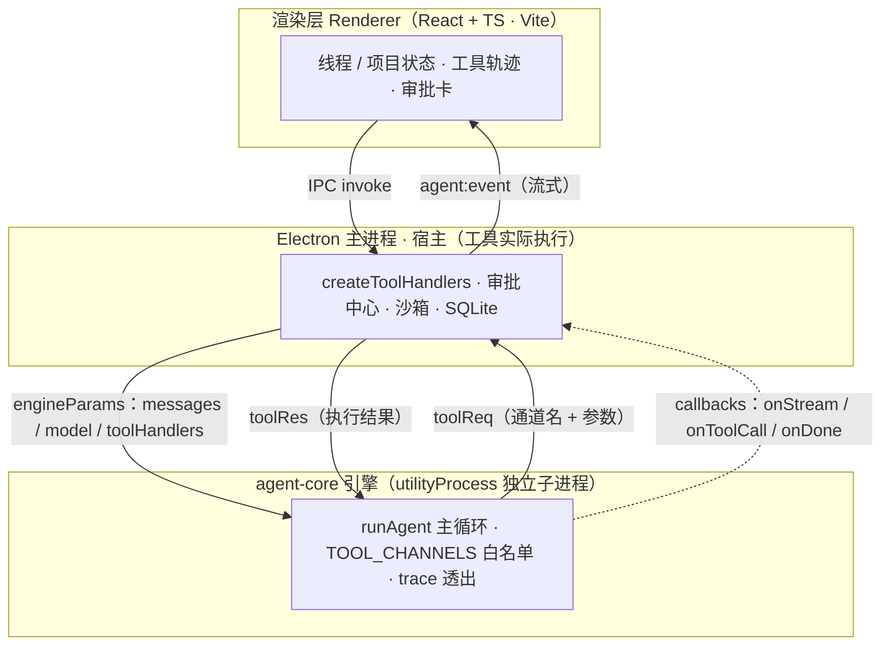
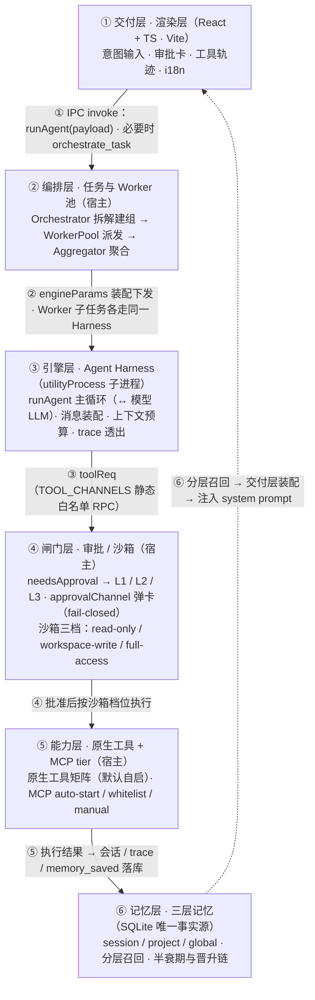
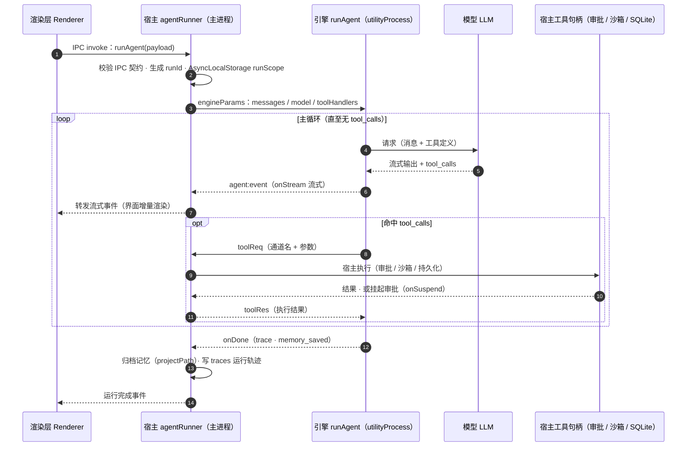
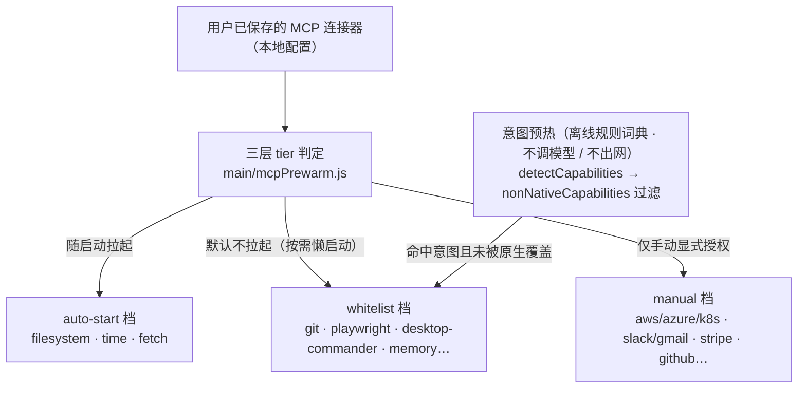
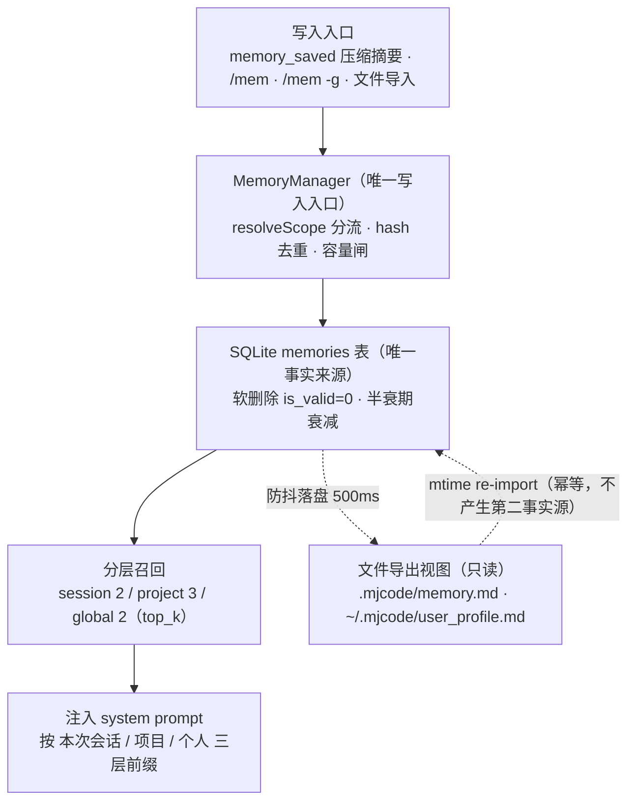
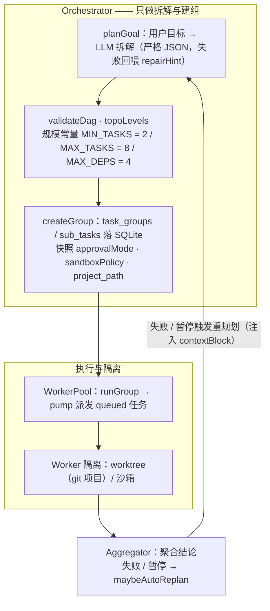
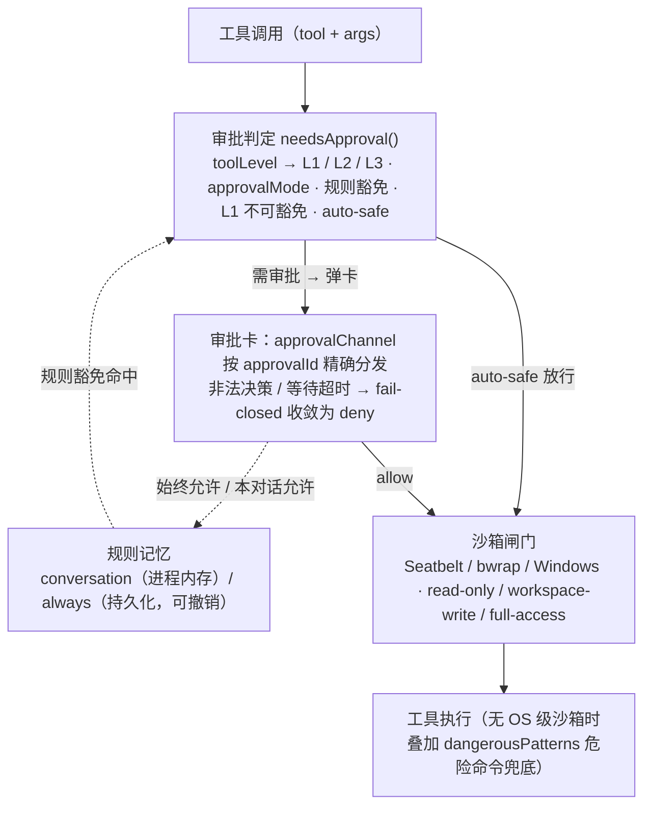

# MJ Coder 技术流程功能文档

> 本文档描述 MJ Coder（本地桌面 Agent 产品）的**完整实现思路、技术流程与功能矩阵**。
> 所有内容均取自当前仓库源码（`desktop/`），标注关键文件与位置，供开发、审查与验收使用。
> 文档以「1.0 版完整视角」撰写，不做版本间对比。

---

## 章节导航

- [一、产品定位与整体架构](#一产品定位与整体架构)
- [二、引擎进程隔离（engineProcess）](#二引擎进程隔离engineprocess)
- [三、Agent Harness 执行流](#三agent-harness-执行流)
- [四、原生工具矩阵与接线规范](#四原生工具矩阵与接线规范)
- [五、MCP 三层治理与意图预热](#五mcp-三层治理与意图预热)
- [六、技能、生态中心与数字员工](#六技能生态中心与数字员工)
- [七、三层记忆体系（M0 ~ M4）](#七三层记忆体系m0--m4)
- [八、任务编排与 Worker 池](#八任务编排与-worker-池)
- [九、审批、沙箱与安全约束](#九审批沙箱与安全约束)
- [十、验证层](#十验证层)
- [十一、i18n 与界面结构](#十一i18n-与界面结构)
- [十二、门禁、CI 与评估](#十二门禁ci-与评估)
- [十三、里程碑现状](#十三里程碑现状)
- [附：关键设计原则速查](#附关键设计原则速查)

### 架构图索引

| 图 | 名称 | 位置 | 表达的核心机制 |
|---|---|---|---|
| 总览图 | 系统总览 · 六大子系统全景 | [1.4 节](#14-系统总览六大子系统全景) | 交付 → 编排 → 引擎（↔ 模型）→ 闸门 → 能力 → 记忆的贯穿路径，以及「分层召回回注 prompt」闭环 |
| 图 1 | 三进程 + 工具 RPC | [1.3 节](#13-三进程--三层运行架构) | 渲染层 / 主进程 / 引擎三进程与 `toolReq`·`toolRes` 反向 RPC |
| 图 2 | Agent Harness 执行流时序 | [3.1 节](#31-工具调用主循环) | 主循环、流式透出、工具回调、trace 与记忆归档的时序 |
| 图 3 | MCP 三层 tier 治理 | [5.1 节](#51-三层权限模型tier) | auto-start / whitelist / manual 三档判定与意图预热接入 |
| 图 4 | 三层记忆读写路径 | [第七章](#七三层记忆体系m0--m4) | 写入分流、SQLite 唯一事实源、分层召回、文件只读视图 |
| 图 5 | 任务编排与 Worker 池流程 | [第八章](#八任务编排与-worker-池) | 拆解建组 → DAG 校验分层 → SQLite 持久化快照 → Worker 池派发与隔离 → 聚合 / 重规划回环 |
| 图 6 | 审批 / 沙箱安全闸门 | [第九章](#九审批沙箱与安全约束) | 审批判定（L1/L2/L3 · L1 不可豁免）→ 弹卡分发（fail-closed）→ 沙箱三档策略 → 危险命令兜底 |

---

## 一、产品定位与整体架构

### 1.1 产品定位

MJ Coder 是一款**本地优先（offline-first）的桌面 Agent 应用**：Electron 桌面壳 + 内嵌 headless Agent 引擎 +
React 渲染界面，对标 codex app 等主流桌面 Agent，**排除云与在线模式**相关能力，核心能力全部在本机闭环运行。

硬约束（架构红线，贯穿全项目）：

- **原生优先**：同一能力只要有原生实现，就永不同时拉起对应的 MCP 连接器，保证同一次运行中两套实现永不「同框」。
- **默认最小权限自启**：默认自启只包含「原生工具 + 少量无密钥 MCP」；带外部密钥 / 宿主命令行 / 浏览器自动化的 MCP 一律只进白名单懒加载或手动授权。
- **Shell/Terminal 类高权限能力绝不默认自启**，必须由用户手动开启并额外配置权限控制。
- **本地存储为唯一事实来源**：记忆、任务、连接器等均以本机 SQLite / 文件为准。
- 移除登录系统，启动后直接进入主页面；无账户体系，但**设置页保留完整配置能力**——按两组共 10 个页签组织（`settings.navGroupSettings`：通用 / 外观 / 模型；`settings.navGroupFeatures`：生态 / 网络 / 浏览器 / Git / Hooks / 记忆 / 团队空间），版本更新区块（`UpdateSection`）归入「通用」页内，不单独成页。

### 1.2 目录结构

```
/Users/jianma/Desktop/MJCode
├── desktop/                 # 桌面端主代码（应用主体）
│   ├── main/                # Electron 主进程（CommonJS）
│   ├── agent-core/          # headless Agent 引擎（ESM，零 Electron 依赖）
│   ├── renderer/            # React + TypeScript 渲染层（Vite 打包）
│   ├── shared/              # 主进程/引擎/渲染层共享的纯函数模块（ESM）
│   ├── shared-ipc/          # IPC 契约（zod 校验）
│   ├── test/                # 发现式全量测试（*.test.{js,mjs} + 2 个 smoke；R7 基线 218+2=220 suite，另 1 个 eval:check gate → 合计 221 个检查项）
│   └── eval/                # 离线评估任务集与自检脚本
├── ecosystem/               # 生态目录（数字员工、MCP 连接器、技能）
├── miniprogram/             # 微信小程序（功能开关默认冻结）
├── chrome-extension/        # Chrome 扩展（浏览器接管能力）
└── server/                  # 本地服务端（Node.js + Express，可选）
```

> 目录树中的 `server/` 技术栈以 `server/package.json` 为准：包名 `mj-code-server@0.6.1-beta`，
> `express@^4.21.0` + `pg@^8.13.0` + `yjs@^13.6.33` + `y-protocols@^1.0.7` + `jsonwebtoken@^9.0.2` +
> `bcryptjs@^2.4.3` + `cors@^2.8.5` + `croner@^10.0.1` + `dotenv@^16.4.5`，入口 `src/index.js`（`node src/index.js` 启动）。
> **不是 Java 技术栈**：该目录下无 `pom.xml` / `build.gradle` / `*.java`（`find server -name "*.java"` 零命中）。

### 1.3 三进程 / 三层运行架构

| 层 | 技术栈 | 职责 |
|---|---|---|
| **宿主（Electron 主进程）** | Node.js (CommonJS) | 窗口与生命周期、IPC 通道、审批中心、沙箱、工具实际执行、凭证保管、SQLite 持久化、任务编排 |
| **引擎（agent-core）** | ESM，headless | LLM 工具调用主循环、消息装配、上下文预算、trace 事件透出；零 `window` / 零 Electron 依赖 |
| **渲染层（renderer）** | React + TypeScript + Vite | 界面与交互、线程/项目状态、工具轨迹可视化、审批卡、i18n |

引擎与宿主之间**通过工具句柄（toolHandlers）解耦**：引擎不认识任何具体工具，只按名称向注入的句柄发起调用；
生产环境进一步把引擎放进 **Electron `utilityProcess` 独立子进程**，使引擎崩溃的半径不覆盖整个应用。



> 关键点：引擎侧**不认识任何具体工具**，只按 `TOOL_HANDLER_NAMES` 映射出的**通道名**向宿主发起 `toolReq`；宿主侧 `TOOL_CHANNELS` 静态白名单是唯一的准入闸——**漏登记会让引擎报「未知工具」甚至重启也无法修复**，因此新增原生工具必须同步更新该白名单与 8 环节接线（详见第四章）。

### 1.4 系统总览（六大子系统全景）

前面各章分别展开单个子系统，本节把**六大子系统**按「**一次任务的贯穿路径**」串成一张全景图：交付层下发意图 → 编排层拆解建组 → 引擎层 Harness 主循环（↔ 模型）→ 闸门层审批 / 沙箱 → 能力层执行（原生工具 / MCP）→ 记忆层落库，最后由**分层召回**回到交付层装配并注入 prompt，形成闭环。

**总览图 · 六大子系统全景**



> 关键点：竖轴是「一次任务的贯穿路径」，横轴是**三进程边界**——①交付层在渲染层，③引擎层在 `utilityProcess` 子进程，②编排层 / ④闸门层 / ⑤能力层 / ⑥记忆层均在 **Electron 主进程**；引擎与宿主之间的每一次调用都走 `TOOL_CHANNELS` **静态白名单 RPC**（图 1）。六个子系统各自的细节见后续章节：引擎执行流（图 2）、编排与 Worker 池（图 5）、审批 / 沙箱闸门（图 6）、原生工具与 MCP tier（图 3）、三层记忆（图 4）；**Worker 子任务会再次进入同一 Harness**，故编排与执行是嵌套关系而非串行关系。

### 1.5 子系统 ↔ 源文件 ↔ 关键常量 对照表

下表是总览图的**口径基准**：每个子系统只列**核心源文件**（不含同目录辅助模块）、**跨会话最易漂移的常量 / 契约**、**该子系统改动后必跑的守护测试**与**回归触发条件**，路径均相对 `desktop/`。任一分图细节调整时，先回看本表是否需要同步；一旦改动命中某行的「回归触发条件」，即按该行「守护测试」列跑最小回归集。

> 本表的常量数值与测试路径由 `desktop/test/docs-consistency.test.mjs` 自动校验（`npm test` 内执行）：源码改了常量而未同步本表、或本表引用了不存在的测试文件，门禁即红。

| 子系统（总览图泳道） | 核心源文件 | 关键常量 / 契约 | 守护测试（`desktop/test/`） | 回归触发条件 | 对应图 |
|---|---|---|---|---|---|
| ① 交付层 · 渲染层（React + TS · Vite） | `renderer/src/components/ChatArea.jsx`（分层召回装配）、`ApprovalCard.jsx`、`MessageStream.tsx`、`renderer/src/hooks/useAgentRun.ts`、`renderer/src/i18n/locales/{zh-CN,en-US}/` | 分层召回前缀 `[本次会话] / [项目] / [个人]`；i18n **仅 zh-CN + en-US**；记忆归档空间键 = `projectPath`（≠ `cwd`） | `ui-conventions.test.js`（界面一致性基线）、`i18n.test.mjs`（双语包 key 完整性）、`smoke-load.mjs` / `render-smoke.mjs`（冒烟） | 改动 `renderer/src/**`（组件 / hooks / i18n 语言包），或新增 / 变更任一 UI 文案 key 时 | 总览图 ① · 图 4 |
| ② 编排层 · 任务与 Worker 池（宿主） | `main/orchestrator/index.js`、`main/orchestrator/dag.js`、`main/workerPool.js`、`main/workerIsolation.js`、`main/worktree.js`、`main/aggregator/merge.js`、`main/taskStore.js` | `MIN_TASKS = 2` / `MAX_TASKS = 8`（提示词与 DAG 校验**共用同一常量**）；迁移 v7 `task_groups.project_path`；召回键 `group.project_path \|\| group.cwd`；建组即快照 `approvalMode` / `sandboxPolicy` | `orchestrator.test.js`（拆解 / DAG / 规模常量）、`workerPool.test.js`（派发 / 组收尾）、`tasks-ipc-wiring.test.mjs`（`tasks:*` deps 契约 + 治理快照接线） | 改动 `main/orchestrator/**`、`workerPool.js`、`taskStore.js`，或 `tasks:*` IPC 通道契约时 | 总览图 ② · 图 5 |
| ③ 引擎层 · Agent Harness（utilityProcess 子进程） | `agent-core/index.js`、`main/agentRunner.js`、`main/engineProcess/{host.js,childEntry.js,registry.js,transport.js}`、`main/modelShape.js`、`main/runTrace.js`、`main/streamGuard.js`、`main/bigPayload.js` | `BASE_TOOLS`（模型可见 schema）/ `TOOL_HANDLER_NAMES`（工具名 → 通道名）/ `TOOL_TIMEOUT_OVERRIDES`（引擎侧超时）；`runAgent(...)`；`TOOL_CHANNELS` **52 条**静态白名单；`NOTIFY_CBS` 8 条 / `REQUEST_CBS` 1 条（`onSuspend`）；`runId` + `AsyncLocalStorage runScope` | `engine-process.test.mjs`（子进程 RPC / 通道白名单）、`tool-registration-matrix.test.mjs`（**8 环节双向差集断言**，防漏登记） | 改动 `agent-core/**` 或 `main/engineProcess/**`，尤其**新增 / 改名任一原生工具**时（须同步 8 环节接线 + 白名单登记） | 总览图 ③ · 图 1 · 图 2 |
| ④ 闸门层 · 审批 / 沙箱（宿主） | `main/approval.js`、`main/approvalChannel.js`、`main/approvalPolicy.js`、`main/approvalSettings.js`、`main/sandbox.js`、`main/sandboxLinux.js`、`main/sandboxWindows.js`、`main/dangerousPatterns.js`、`main/computerUse.js`、`main/cuaProcess/` | `LEVELS = { L1: danger-command, L2: file-write, L3: mcp-tool }`；`APPROVAL_MODES = { never, auto-safe, on-request（默认）, always }`；**L1 不可豁免** + 非法决策 / 超时 **fail-closed → deny**；沙箱三档 `read-only / workspace-write / full-access`；规则库 `userData/approval-rules.json`（可撤销） | `approval.test.js`（分级 / `needsApproval` / 可补偿性）、`approvalChannel.test.js` / `approval-queue.test.js`（按 `approvalId` 分发 / fail-closed）、`exec-governance.test.mjs`（载荷只能收紧不能放宽）、`computer-use-wiring.test.mjs`（CUA 强门控） | 改动审批档位 / 分级 / `needsApproval` / 沙箱策略，或新增「可被审批」的工具时 | 总览图 ④ · 图 6 |
| ⑤ 能力层 · 原生工具 + MCP tier（宿主） | `main/nativeTools.js`、`main/codeTools.js`、`main/codeProcess/`、`main/nativeSandbox/`、`main/webTools.js`、`main/docTools.js`、`main/latexTools.js`、`main/mcpPrewarm.js`、`main/intentMcpPrewarm.js`、`main/mcpClient.js`、`main/mcpAutoReconnect.js`、`main/mcpToolCache.js`、`main/tools/timeouts.js` | `TIER = { auto-start, whitelist, manual }`；`PREWARM_NAMES = { filesystem, time, fetch }`；`DEVELOPER_AUTO_START_NAMES = { git, git-mcp }`；`MANUAL_NAMES`；灰度开关 `MJCODE_MCP_LAZY`；`SHELL_DEFAULT_TIMEOUT_MS = 480000` / `SHELL_WATCHDOG_TIMEOUT_MS = 600000` | `mcp-lazy-prewarm.test.mjs`（tier 判定 / 懒启动）、`mcp-governance.test.mjs`（三层治理）、`timeouts-contract.test.mjs`（超时常量契约）、`native-tools-p3.test.mjs` / `native-doc-tools.test.mjs` / `native-latex-tools.test.mjs`（原生工具接线）、`code-mode.test.mjs`（Code Mode） | 改动原生工具实现、超时常量、MCP tier 判定 / 懒启动灰度开关时 | 总览图 ⑤ · 图 3 |
| ⑥ 记忆层 · 三层记忆（SQLite 唯一事实源） | `main/memory/index.js`、`main/memory/scorer.js`、`main/memory/memoryFile.js`、`main/memory/bgScheduler.js`、`main/db/index.js` | `SCOPES = ['session','project','global']`；`SOURCE_DEFAULT_SCOPE`（来源 → 默认作用域，`resolveScope` 为唯一事实来源）；`LAYER_QUOTA = { session: 2, project: 3, global: 2 }`；半衰期 session 7 / project 30 / global 90 天（未知回落 14）；`SALVAGE_MIN_HITS = 3` / `PROMOTE_L1_MIN_HITS = 3` / `PROMOTE_L2_MIN_HITS = 5`；`MAX_MEMORIES_PER_SPACE = 500` / `MAX_GLOBAL_MEMORIES = 300` / `RECALL_TOP_K_MAX = 50` | `memory.test.js`（写入 / 去重 / 容量闸）、`memory-scope.test.mjs`（`resolveScope` 分流）、`memory-salvage.test.mjs`（salvage + 晋升阈值）、`memory-m4-hardening.test.mjs`（半衰期 / 全局硬闸）、`memory-file-channel.test.mjs`（文件只读双通道）、`memory-mem-command.test.mjs`（`/mem` 分流） | 改动记忆写入 / 召回装配 / 晋升阈值 / 半衰期 / 容量闸，或 `/mem` 分流规则时 | 总览图 ⑥ · 图 4 |

**门禁运行方式**（均在 `desktop/` 下执行，上表「守护测试」列即对应子系统改动后**必跑的最小回归集**）：

| 命令 | 作用 | 通过标准 |
|---|---|---|
| `npm test` | 发现式全量测试（`test/run-all.mjs` 自动扫描 `test/**/*.test.*`），已把 `eval --check` 作为**前置门禁**并入 | 全量套件全绿（当前 220 套） |
| `npm run typecheck` | 全量 TS/JSX 类型检查 | **零错误** |
| `npm run lint` | 静态规则检查（棘轮） | **0 error / ≤161 warnings**，警告数不得反弹 |
| `npm run eval:check` | 离线评估自检（`eval/run-eval.mjs --check`） | 自检通过（亦为 `npm test` 前置） |

> 口径：表内「守护测试」列只列**该子系统的定点回归**，并非全集；跨子系统改动（如新增原生工具的 8 环节接线）须以 `tool-registration-matrix.test.mjs` 的双向差集断言为准，跑全量 `npm test` 兜底。

---

## 二、引擎进程隔离（engineProcess）

### 2.1 设计动机

原生引擎若直接运行在 Electron 主进程，会带来三类问题：崩溃半径覆盖整个应用、主进程卡顿连锁、失控任务难回收。
解决方案是把 `agent-core` 迁入 Electron `utilityProcess` 独立子进程，通过 RPC 回调主进程工具实现——
无需重写引擎即可获得绝大部分进程隔离收益。

### 2.2 关键模块

- `main/engineProcess/host.js`：生产环境经 `utilityProcess.fork` 启动引擎子进程并设置内存上限；主进程作为**工具执行端**处理 `toolReq`，在本进程内执行审批 / 流式推送 / 凭证解析，再把结果经 `toolRes` 回传子进程。
- `main/engineProcess/childEntry.js`：子进程侧为 `TOOL_CHANNELS` 中每个通道生成 RPC 工具代理，等待 `toolRes`——这实现了「引擎调用主进程能力」的反向依赖。
- `main/engineProcess/registry.js`：**工具通道静态白名单** `TOOL_CHANNELS`。子进程只能回调登记在其中的句柄；**漏登记会导致 `resolveChannel` 返回 `null`、引擎报「未知工具」**（重启应用也无法修复）。新增原生工具必须同步更新此白名单。
- `main/engineProcess/transport.js`：传输适配层，兼容 Electron `utilityProcess`（`parentPort`）与 Node `child_process.fork`（`process.send`），统一 `send/onMessage/onExit/kill`。

### 2.3 回调分类

`registry.js` 把回调分为两类：

- `NOTIFY_CBS`（通知型，fire-and-forget）：`onStream` / `onToolCall` / `onMessage` / `onTodos` / `onSubagentEvent` / `onBudget` / `onTrace` / `onDone`。
- `REQUEST_CBS`（请求-响应型，需要返回值语义）：`onSuspend`（返回断点是否保存成功）。

---

## 三、Agent Harness 执行流

### 3.1 工具调用主循环

引擎入口 `agent-core/index.js` 定义了标准循环：

```
用户消息 → LLM → tool_calls → 执行工具 → 结果回传 → LLM → …… → 完成
```

- 主循环导出入口为 `runAgent(...)`（`agent-core/index.js:2131` 附近），参数包含 `messages / model / onToolCall / onDone / onMessage` 等，是 LLM 循环、工具调用与完成事件透出的核心函数。
- 每轮把 `tool_calls` 逐条解析为 `camelCase` 通道名（经 `TOOL_HANDLER_NAMES` 映射），再查句柄。

**图 2 · Agent Harness 执行流时序**



> 关键点：**引擎只跑循环、不碰宿主能力**——所有工具执行经 `toolReq` 反向回调给主进程；流式输出经 `agent:event` 逐级转发到渲染层；`memory_saved` 只通过 trace 通道透出，由主进程统一归档（引擎不直接操作存储）。

### 3.2 工具句柄注入（零 Electron 依赖）

- 引擎不写静态工具实现，所有工具与模型调用经 **`toolHandlers` 注入**；未提供时回落兼容路径 `globalThis.window.mjcode`。
- 解析入口 `resolveChannel`（`agent-core/index.js:1568` 附近）：优先从注入的 `toolHandlers` 按通道名取句柄，否则回落旧兼容路径。
- 工具名 → 通道名的唯一映射表为 `TOOL_HANDLER_NAMES`（`agent-core/index.js:1024`），例如 `read_file → readFile`、`web_search → webSearch`、`sandbox_code_run → sandboxCodeRun`。

### 3.3 宿主侧运行生命周期（agentRunner）

`main/agentRunner.js` 是主进程侧 Agent 运行的编排者：

- **启动**：校验 IPC 契约 → 生成 `runId` → 创建 `AbortController` 与事件发射器。
- **装配**：组装 `engineParams`、创建宿主 `toolHandlers`，并包装 `deps.toolHooks`（决定哪些参数 / 工具 / 审批策略进入引擎及 hooks 执行顺序）。
- **运行上下文**：`main.js` 用 `AsyncLocalStorage`（`runScope`）承载 `{ runId }`，使工具句柄在运行上下文中执行——
  - `requestApproval` 据此把挂起审批挂到 `runId`（运行取消 → `cancelApprovalsForRun` 统一撤下）；
  - `exec.js` 据此把 shell 子进程注册到 `runId`（运行取消 → `killChildrenForRun` 终止子进程）。
- **事件透出**：`makeEmitter` 在发送前做契约校验，非法载荷不静默丢弃，而是降级为同 `runId` 的 error 事件，便于定位字段漂移。

### 3.4 消息装配与模型转换

- 模型形状转换由 `main/modelShape.js` 统一：`toAgentModel`（嵌套形 → 扁平形）与 `toChatRequest`（扁平形 → 请求体），是全项目唯一事实来源，避免两处各写一份导致静默拿到 `undefined`。
- 图片输入进入模型主对话通道时，持久化与界面展示保持文本 `@path` 引用，不修改数据库结构；**仅在运行时装配为 OpenAI 兼容的 `image_url` 数据部件**传入模型。排除 SVG 格式并设 12MB 上限，超限返回结构化错误。

### 3.5 上下文预算与记忆透出

- 引擎内部做粗略 token 估算（中日韩字符约 1 token/字，其余约 1 token/4 字符）用于上下文预算。
- 会话落盘：当存在 `sessionDir` 时，把消息写入 `${sessionDir}/session.jsonl`，持久化 `tool_calls`、`tool_call_id`、token 用量等字段。
- **记忆持久化采用分层架构**：`agent-core` 仅在压缩完成后通过 **trace 通道**发出 `memory_saved` 事件，**不直接操作存储**；由主进程 `agentRunner` 统一收纳归档。归档采用 `projectPath` 作为空间键，避免临时工作目录使记忆散入一次性空间；归档失败采用 **fail-open**，不阻塞主任务。

### 3.6 trace 与诊断

- `main/runTrace.js`：`appendTraceEvent` 把引擎 trace 事件按运行写入 `userData/traces/<runId>.jsonl`，用于本地诊断与断点恢复分析。
- `main/streamGuard.js`：对模型流式输出做守卫（防异常/半截输出污染）。
- `main/bigPayload.js`：大载荷外置（如 `offloadToolCall`），避免超大工具结果撑爆 IPC 与上下文。

---

## 四、原生工具矩阵与接线规范

### 4.1 完整原生工具清单

原生工具在 `agent-core/index.js` 的 `BASE_TOOLS` 中声明（模型可见 schema），主进程 / 渲染层提供同名句柄。当前清单：

| 类目 | 工具（模型名） |
|---|---|
| 插件 | `search_plugins`、`install_plugin` |
| 文件系统 | `read_file`、`write_file`、`edit_file`、`apply_patch`、`list_dir`、`grep`、`glob` |
| Git | `git_status`、`git_diff`、`git_log`、`git_commit`、`git_add`、`git_branch` |
| Shell | `shell`（含 `argv` 数组直调，绕开 shell 更安全） |
| 定时任务 | `scheduled_create` |
| PR 审查 | `pr_list`、`pr_view`、`pr_diff`、`pr_review`、`pr_comment` |
| 编排 | `spawn_subagent`、`orchestrate_task` |
| 网络 | `web_search`、`web_fetch`、`deep_research` |
| 浏览器自动化（MCP 型） | `browser_navigate/click/fill/select/screenshot/extract` |
| Chrome 接管 | `chrome_status/tabs/navigate/click/fill/screenshot/extract` |
| 代码执行 | `code_exec`（Code Mode） |
| 待办 | `todo_write` |
| 原生系统能力 | `clipboard`、`notify`、`http_request`、`sqlite` |
| 沙盒代码 | `sandbox_code_run`（独立沙盒） |
| 文档生成 | `doc_create`、`xlsx_create`、`pptx_create`、`pdf_generate` |
| LaTeX | `latex_compile` |
| 技能 | `load_skill` |
| 桌面自动化 | `computer_use`（opt-in，强门控） |

> **内置 vs MCP 的边界**：本地系统原生能力（剪贴板、桌面通知、HTTP 客户端、SQLite、沙盒代码执行、文档生成）一律做**内置原生工具**；仅「外部依赖 / 第三方服务 / 可插拔扩展」才走 MCP 连接器。仅付费全网搜索（Brave/Tavily/Exa）保留 MCP 实现。

### 4.2 「8 环节接线」规范

新增一个原生工具，必须在**以下 8 个环节全部接线**，缺一即出现功能异常（典型症状：模型「有声明无通道」或子进程报「未知工具」）：

| 环节 | 说明 | 对应位置 |
|---|---|---|
| 1. 引擎 schema | 在 `BASE_TOOLS` 声明工具与参数 | `agent-core/index.js` |
| 2. 通道映射 | 在 `TOOL_HANDLER_NAMES` 登记模型名 → 通道名 | `agent-core/index.js` |
| 3. 子进程白名单 | 在 `TOOL_CHANNELS` 登记（否则 utilityProcess 报未知工具） | `main/engineProcess/registry.js` |
| 4. 主进程接线 | 在 `createToolHandlers` 实现句柄 | `main/main.js` |
| 5. 审批分级 | 在审批矩阵给出级别（L1/L2/L3） | `main/approval.js` |
| 6. 超时配置 | 登记超时（避免默认超时误杀长任务） | `main/tools/timeouts.js` |
| 7. 可补偿性 | 声明失败是否可补偿（校验/回滚语义） | 审批与验证策略 |
| 8. UI 工具轨迹标签 | 在工具轨迹映射中文标签 | `renderer/src/components/tools/ToolTrace.tsx` |

上述 8 环节的一致性由**工具登记矩阵**统一守护：

- 单一事实来源：`BASE_TOOLS ∪ TOOL_HANDLER_NAMES` 派生出「模型可见工具清单」。
- 双向差集断言：对 8 环节逐一做覆盖差集检查，配合显式白名单承载合理豁免，避免聚合断言恒绿。
- 测试文件：`desktop/test/tool-registration-matrix.test.mjs`。

### 4.3 原生工具统一管控

所有原生工具统一接入同一套管控体系：

- `main/nativeTools.js`：原生能力实现与**统一审批闸** `gateApproval(toolKey, args)`。
- 统一的调用审计、高危操作弹窗、能力降级开关（文件只读/读写、沙盒网络开闭）。
- 沙盒代码工具 `sandbox_code_run`：**Node VM + 独立子进程 + 网络开关 + 超时 + 资源限制**，与宿主 shell 彻底解耦；宿主 shell 永久脱离自动启动列表。
- web 抓取工具的**重定向跟随**改为手动逐跳校验目标地址后再执行请求，杜绝公网 302 跳转绕过校验访问内网的 SSRF 旁路。

---

## 五、MCP 三层治理与意图预热

### 5.1 三层权限模型（tier）

`main/mcpPrewarm.js` 把 MCP 服务分三级：

| 档位 | 判定口径 | 行为 |
|---|---|---|
| **auto-start** | 开箱即用刚需、低风险、无外部强鉴权、稳定通用 | 随启动拉起 |
| **whitelist** | 中风险 / 无需外部密钥但非刚需 | 默认**不**拉起，按需懒启动 |
| **manual** | 高危 / 付费 / 第三方 / 带外部密钥 | 绝不默认自启，仅用户手动显式授权添加 |

**默认自启集合**（`PREWARM_NAMES`）：`filesystem`（工作区沙盒读写）、`time`（时区与日期计算）、`fetch`（已知 URL 只读抓取）；
另有包名兜底 `PREWARM_PKGS`，防止用户重命名后白名单失效。

`whitelist` 例：`git`、`playwright`（浏览器自动化）、`desktop-commander`（宿主 shell）、`memory`、`context7`、`deepwiki`。
其中「开发者档（profile=developer）」可额外把 git 类纳入自动启动（`DEVELOPER_AUTO_START_*`）。

`manual` 例：云与基础设施（aws/azure/kubernetes…）、消息与邮件（slack/gmail/discord…）、支付（stripe/paypal…）、第三方 SaaS（github/notion/atlassian…）等（`MANUAL_NAMES` / `MANUAL_PKGS`）。

**生效纪律**：三层分级**默认生效**——启动只拉起 auto-start 档，whitelist/manual 一律按需懒连接。
仅当显式设置 `MJCODE_MCP_LAZY=0/false/off` 时才回落到旧行为（启动全量重连），该开关只用于排障/兼容，不作为常规运行路径。

**图 3 · MCP 三层 tier 治理**



> 关键点：**默认只有 auto-start 档随启动拉起**；whitelist 档由「意图预热」命中且未被原生能力覆盖时才懒连接；manual 档（高危 / 付费 / 第三方 / 带密钥）**绝不默认自启**。连接侧统一遵守「只连用户已保存的连接器 + 有界并发 + 单服务 6s 超时 + fail-open」，任一失败只告警、不影响本轮运行。

### 5.2 意图驱动的 MCP 懒启动

`main/intentMcpPrewarm.js` + `main/mcpPrewarm.js` 实现「按输入文本意图自动判定加载哪些 MCP」：

- **离线规则词典**：不调模型、不出网，保证零延迟、可解释、无额外成本（`detectCapabilities` 做关键词匹配）。
- **原生优先过滤**：`nonNativeCapabilities` 排除已被原生工具覆盖的能力（doc/xlsx/pptx/pdf/web/browser/code）——命中意图若已有原生实现则直接跳过 MCP。
- **只连用户已保存的连接器**：本模块不新建任何 MCP 服务实例；已在本轮 `mcpTools` 中的服务不重复连。
- **有界并发 + 单服务超时（`PREWARM_CONNECT_TIMEOUT_MS`）+ fail-open**：任一连接失败/超时都只告警，绝不影响本轮运行。
- **观测（governanceStats）**：区分「没命中意图（noIntent）」「命中了但全被原生覆盖（nativeCovered）」「已全部在场（satisfied）」「真连上（connected）」等状态。

运行时常量：工具定义构造统一取自 `shared/mcpToolDefs.mjs`（与渲染层同一实现），并按「服务名 → 工具名」稳定排序后展开，保证相同配置下披露序列字节稳定（前缀缓存友好）。

### 5.3 「MCP 不得默认注入每条对话」的实现

`main/ipc/mcp.js` 的 `mcp:listTools` **只返回已连接服务**（`connected:true`）的工具清单。
此前存在的「已保存但未连接服务的缓存清单兜底」循环**已移除**——该兜底会把全部已保存 MCP 工具注入每一条对话，违反「MCP 默认全关、仅自选或意图判定加载」的架构约束。
未连接服务的工具改由**意图预热**在命中意图时按需连接后纳入本轮。

### 5.4 MCP 连接与运维

- `main/mcpClient.js`：工具名清洗与注册（服务端原始工具名规范化为模型可用名，并维护 `exposedName → originalName` 映射）。
- `main/mcpAutoReconnect.js`：重连采用**有界并发**，避免串行启动拉长工具可用时间；完成后输出汇总统计。
- `main/mcpStdioTransport.js`：stdio 服务密钥通过环境变量配置表单输入。
- 启动参数占位符必须在连接前完成替换；未填充参数会导致服务静默不可用，连接前做合法性校验，参数缺失时明确拒绝连接而非返回假健康状态。
- `stderr` 与 `notifications/message` 默认仅透传 warn/error，可用 `MJCODE_MCP_VERBOSE` 开启全量。
- 授权双轨分流：oauth 类型远程服务走浏览器授权引擎；paste_key 类型保留粘贴令牌入口；stdio 类走环境变量；手动类型仅提供文档指引。**OAuth 令牌全程在 Electron 主进程闭环处理**，不经渲染进程 IPC 传递。

---

## 六、技能、生态中心与数字员工

### 6.1 技能体系

- 内置技能在渲染层注册（`renderer/src/lib/builtinSkills.ts`），技能通过 `load_skill` 工具在运行时载入。
- `main/skillCompat.js`：**SKILL.md 兼容层**，兼容外部 SKILL.md 技能格式。
- `main/pluginDiscovery.js` / `pluginMarket.js`：插件发现与市场（本地已装 + 本地市场索引 + 公网源合并去重）。
- 技能与 MCP 的区别：技能是**提示词与工作流知识**（不引入新进程/连接），MCP 是**外部能力连接器**（独立进程/远程服务）。

### 6.2 生态中心

- 生态目录位于 `ecosystem/`（随包分发至 `extraResources/ecosystem`）。
- 来源合并：`mcp-connectors.json`（精选目录，有「条目数 ≤ 90」的防膨胀不变式）+ `mcp-connectors-workbuddy.json`（从 WorkBuddy 目录导入，id 前缀 `wb-`）。去重规则为**精选优先**（先按安装地址，其次按 name）。
- 数字员工卡片**无需下载按钮**：所有内容均为本地存储，仅保留「详情」与「招募」两个操作按钮。

### 6.3 数字员工（Digital Employees）

`main/ecosystem.js` 的 `loadDigitalEmployees` 加载 `digital-employees.json`，并对每项做**归一化与 fail-closed 保护**：

- 非法策略值降级为最保守默认，避免生态数据绕过审批矩阵。
- 员工角色映射为运行时 **`rolePreset`**：工具子集（`tools`）、审批档（`approval_policy`）、沙箱档（`sandbox_policy`）、起步技能（`starter_skills`）、模型档（`default_model_tier`）。

---

## 七、三层记忆体系（M0 ~ M4）

记忆以 **SQLite 为唯一事实来源**，文件仅作只读导出视图。核心模块：`main/memory/index.js`（唯一写入入口）、`scorer.js`、`memoryFile.js`、`bgScheduler.js`。



> 关键点：写入必须先经 `MemoryManager` 的 `resolveScope` 分流（来源 → 默认作用域的**唯一事实来源**），再落 SQLite；文件 `memory.md` / `user_profile.md` **只读导出**，经防抖落盘与基线 `mtime` 幂等 re-import 与库双向同步，**绝不作为第二事实源**；召回按会话/项目/个人三层前缀装配注入 prompt。

### 7.1 作用域（scope）与语义域（domain）

- **scope（记忆层级，可见范围与生存周期）**：`session` / `project` / `global`，顺序即晋升优先级（只允许自左向右晋升）。
  - `session`：本轮会话工作记忆，绑定 `conversation_id`，仅同会话可见（最强时效、最快衰减）。
  - `project`：项目记忆，按 `space_id` 分区，项目内跨会话可见。
  - `global`：全局记忆，跨项目可见，仅「用户显式确认」的可信资产允许写入。
- **domain（语义分类）**：`private` / `session` / `global_knowledge` / `entity` / `reflection`。
- **tier（层级）**：Tier0 瞬时（仅内存） / Tier1 原文 / Tier2 压缩摘要 / Tier3 长期固化。

**来源可信度**（随 `source` 列持久化，读取时确定性推导）：`user_input 1.0 > model_conclusion 0.6 > external_content 0.2`。

### 7.2 写入分流（唯一事实来源 `resolveScope`）

来源 → 默认作用域：`user_input → project`、`model_conclusion → session`、`compressor → project`、`external_content → session`、`legacy-import → project`。

两条硬约束：

1. `external_content` 不可信 → **强制收敛到会话层**（禁止跨会话/跨项目传播不可信内容）；
2. 全局层是「用户显式确认的跨项目资产」→ 非 `user_input` 一律降级项目层（防自动沉淀污染全局）。

低可信来源（`external_content`）默认不进 system prompt 注入，仅当 query 显式命中（词法相关性 > 0）时按低权重返回。

### 7.3 写入路径

| 路径 | 目标 | 说明 |
|---|---|---|
| `memory_saved`（压缩摘要） | **L2 项目级** | 压缩完成后由引擎 trace 透出、主进程归档；默认写项目级，禁止写 L1 以避免跨会话晋升死结 |
| `/mem <内容>` | **L2 项目级** | `scope:'project'` + `domain:'global_knowledge'` |
| `/mem -g <内容>` | **L3 全局级** | `scope:'global'` + `domain:'private'` |
| 外部文件导入 | 视来源 | 全局文件以 `source:'user_input'` 导入，与 `resolveScope` 全局硬约束对齐 |

记忆写入入口对 `domain`/`scope` 做白名单校验，非法值自动回落默认值。

### 7.4 去重与幂等

内容归一化（trim / 连续空白压缩 / 大小写折叠）后取 sha1 前 16 位 hash；同 `space+domain+hash` 已存在则**刷新元数据**（`updated_at` / `usage_count` / `source`）而非重复 INSERT。

### 7.5 分层召回

- 分层模式（`scopes` / `conversationId`）输出 `scope`，渲染层据此加**层级前缀**注入（按「本次会话 / 项目 / 个人」三层前缀注入），`agent-core` 无需改动，仅在 `ChatArea.jsx` 层完成装配。
- 受控注入预算：`LAYER_QUOTA = { session: 2, project: 3, global: 2 }`，合计 7 条上限。
- 容量总闸：`RECALL_SCAN_LIMIT=200`（单次扫描打分行数）、`RECALL_TOP_K_MAX=50`、`MAX_MEMORIES_PER_SPACE=500`；`MAX_GLOBAL_MEMORIES=300`（L3 全局层独立容量闸，跨空间按 scope 计数 + LRU 硬淘汰）。容量闸抽象为 `_enforceCap` 统一实现。

### 7.6 半衰期与晋升链（M2 / M4）

- **半衰期按 scope 差异化**（`scorer.HALF_LIFE_DAYS_BY_SCOPE`）：`session 7 天 / project 30 天 / global 90 天`，`domain` 表作兼容回落，兜底 14 天。
- **失效与清理**：`invalidate` 为**软删除**（`is_valid=0` 保留行），`INVALID_GRACE_MS = 7 天` 后由 cleanupJob 物理删除。
- **晋升链（阈值单一事实来源）**：
  - 会话删除 salvage：`SALVAGE_MIN_HITS=3`（或 `tier≥3`）的 L1 → 沉淀为 L2，其余 L1 物理删除。
  - 后台 `promote-scope`：L1 命中 `≥3` → L2；L2 命中 `≥5` 且来源 `user_input` → L3。
  - 晋升 `Tier3` 后永不被衰减/清理。salvage 采用 fail-open，异常不阻断会话删除。

### 7.7 文件双通道（M3）

- SQLite 为唯一事实来源；文件（项目级 `.mjcode/memory.md`、全局级 `~/.mjcode/user_profile.md`）仅作**只读导出视图**。
- 采用 500ms 防抖落盘 + 基线 mtime re-import 幂等实现双向同步，不产生第二事实源。
- 变更通知 `onChange` 驱动导出视图；`importItems` 支持 `onlyNew`（幂等跳过已存在内容，避免覆盖来源/语义域）。
- 项目级记忆文件默认加入 `.gitignore`，提供团队共享开关。

---

## 八、任务编排与 Worker 池

编排层遵循「**只做拆解与建组**」的职责边界：执行交给 WorkerPool，聚合交给 Aggregator，Orchestrator 自身不做执行。

**图 5 · 任务编排与 Worker 池流程**



> 关键点：**建组时刻即快照宿主治理档位**（`approvalMode` / `sandboxPolicy` / `project_path`）并随组持久化；Worker 执行期从组快照读 `project_path` 作为记忆召回的**统一空间键**（worktree 隔离下 `cwd` 是临时目录，故不可用 `cwd`）；召回键为 `group.project_path || group.cwd`，历史组无该列时回落 `cwd`。

### 8.1 编排（Orchestrator）

`main/orchestrator/` 是「最小版 Orchestrator」，职责边界：**只做拆解与建组**；执行交给 WorkerPool，聚合交给 Aggregator。

- `planGoal({ goal, cwd, projectPath, ... })`：用户目标 → LLM 拆解 → `validateDag` 校验 → `topoLevels` 拓扑分层 → `store.createGroup` 持久化任务组。
- 拆解提示与 DAG 校验**共用同一规模常量**（`MIN_TASKS = 2` / `MAX_TASKS = 8` / `MAX_DEPS = 4`，定义于 `main/orchestrator/dag.js:8-10`），消除「提示说 2~6、校验允 8」的双重口径漂移。
- 拆解输出严格 JSON；非法 JSON 时**自动回喂修复**（`repairHint`），最多重试 1 次。
- `autoOrchestrate`：一键流（目标 → 自动拆解 → 自动执行），即 WorkBuddy 式主理人模式。
- `maybeAutoReplan`：失败/暂停组自动重规划，注入「上次执行情况」（已完成结论 / 失败原因）作为 `contextBlock`。
- 建组时刻快照宿主治理（`approvalMode` / `sandboxPolicy`），随组持久化；`threadId` 使组绑定会话，渲染层据此归属显示。

### 8.2 DAG 与持久化

- `main/orchestrator/dag.js`：`validateDag` / `topoLevels` / 规模常量。
- `task_groups` / `sub_tasks` 落 SQLite；**迁移 v7 新增 `task_groups.project_path`**——为任务组持久化项目路径，作为 Worker 记忆召回的**统一空间键**。
  - Worker 执行期从组快照读 `project_path`，避免「调用方漏传即静默回落」的漂移；历史组无该列时回落 `cwd`（向后兼容）。
  - 召回键：`group.project_path || group.cwd`。

### 8.3 Worker 池与隔离

- `main/workerPool.js`：`runGroup()` 启动组，`pump()` 从 running 组中派发 queued 任务，处理组收尾与关键失败暂停。
- `main/workerIsolation.js`：Worker 隔离手段。
- `main/worktree.js`：git 项目可用 worktree 隔离并行任务（注意此时 `cwd` 是临时隔离目录，故召回空间键必须用 `project_path`）。

### 8.4 定时任务（无人值守）

- `main/scheduledStore.js`：定时任务持久化（本地、离线可用）。
- `main/scheduler.js`：到点自动执行提示词。
- `main/scheduledChannels.js`：无人值守执行通道，透传 `projectPath`（`orchestrateTask` 补 `projectPath: rc.dir`）。
- 创建定时任务的动作 = 持久化 + 未来无人值守自动执行，故**恒走 L3 审批**（`main/scheduledTools.js`）。
- 无人值守路径的审批/沙箱档来源为**用户设置**（`approvalSettings`），与交互 run 的 payload 档严格分开。

---

## 九、审批、沙箱与安全约束

工具调用在执行前后各过一道闸门：**审批闸门**（是否弹卡、谁批准）与**沙箱闸门**（以何种隔离级别被执行）。

**图 6 · 审批 / 沙箱安全闸门**



> 关键点：审批判定有两条**不可逆红线**——**L1 不可豁免**（逐次审批）、非法决策与超时一律 **fail-closed 收敛为 deny**；「始终允许」规则必须可见可撤销（`approval:listRules` / `approval:deleteRule`）。沙箱侧按 `read-only / workspace-write / full-access` 三档生成 OS 级隔离；仅当 OS 级沙箱不可用时，才叠加危险命令规则兜底，避免重复拦截项目内合理命令。

### 9.1 审批中心

- `main/approval.js`：审批档位定义（四档互斥枚举）与工具 → 级别映射（L1/L2/L3）。
  - `shell` / `git` / `mcp` / `browser` / `chrome` / `code_exec` / `computer_use` 等工具的级别在此明确。
  - `toolLevel(tool, args)` 决定级别；`needsApproval(...)` 依据 approvalMode、规则豁免、**L1 不可豁免**、auto-safe 放行等逻辑决定是否弹卡。
- **规则记忆**：`conversation`（本对话同类，进程内存）与 `always`（「始终允许」，持久化到 `userData/approval-rules.json`，走 `writeFileDurable` 防写坏）。
- **可撤销**：「始终允许」规则必须可见可撤销——提供 `approval:listRules` / `approval:deleteRule` IPC。
- `main/approvalChannel.js`：并发审批**按 `approvalId` 精确分发**，防串扰与张冠李戴；非法决策 fail-closed 收敛为 `deny`；等待带超时 deny。
- 无可用窗口时 fail-closed 按 deny 收尾（不对 `mainWindow.webContents` 裸解引用）。
- 审批结束广播（`tool:approval-end`），让渲染层撤下卡片，避免主进程 pending 超时消失而 UI 卡片仍挂着。
- `main/approvalPolicy.js` / `approvalSettings.js`：策略与设置来源。

### 9.2 沙箱体系

- `main/sandbox.js`：macOS **Seatbelt** profile 生成，按 `read-only / workspace-write / full-access` 策略生成规则（写路径白名单、保护目录 deny、网络限制）。
- `main/sandboxLinux.js` / `sandboxWindows.js` / `main/nativeSandbox/`：Linux（bwrap）与 Windows 沙箱实现。
- 命令级安全兜底：当 OS 级沙箱不可用时，按**危险命令规则**（`main/dangerousPatterns.js`）拦截；有 OS 级沙箱时放行，避免重复拦截项目内合理命令。
- 三平台可用性判定：根据 policy / cwd / 后端能力决定是否启用 OS 级隔离。
- `main/writeGuard.js` / `main/ipc/sandbox.js`：写路径白名单守卫与沙箱 IPC。

### 9.3 网络与 SSRF

- `main/webTools.js`：Web 检索/抓取（含 SSRF 防护、HTML 转文本、超时与体积上限）。
- **重定向跟随改为手动逐跳校验目标地址后再执行请求**：防止公网 302 跳转绕过目标地址校验访问内网服务。
- 网页 Fetch（只读 GET）与 Web Search 拆分为独立能力，适用不同权限规则。

### 9.4 桌面自动化（computer_use）

采用 **opt-in 强门控**：

- **默认关闭**，仅在 macOS 环境且用户手动在设置页开启后才**动态追加**到工具列表，不进入静态清单，避免默认暴露高风险能力。
- 所有调用统一走**全局标准审批中心通道**，采用**L1 逐次审批 + 应用白名单 + `maxSteps` 上限 + `cuaProcess` 子进程隔离**的多层防护，禁止使用独立审批通道。
- 工具名 `computer_use` 必须在 `engineProcess/registry.js` 的 `TOOL_CHANNELS` 登记（否则子进程报「未知工具」）。

---

## 十、验证层

- `main/verifyPolicy.js`：
  - 定义风险面——区分 `external/mutating` 工具与危险 shell，用于 L3 验证触发与无人值守交付裁决。
  - L3 触发策略：仅 `l3` 档位运行，按 `risk/onBlock/sample` 条件决定是否调用独立评审。
  - **无人值守交付门禁 fail-closed**：L3 未产出、`FLAG`、`BLOCK` 都会降级交付，防止未验证运行被宣告成功。
- `main/verifyRun.js`：验证运行编排。
- `agent-core/verifier.js`（V-L1）与 `agent-core/verifierL3.js`（V-L3）：引擎侧验证器。

---

## 十一、i18n 与界面结构

### 11.1 国际化

- `renderer/src/i18n/index.ts`：**仅支持 zh-CN / en-US**，语言包按模块拆分，默认 zh-CN。
- 缺失 key 处理：en-US 缺失回落 zh-CN，再缺返回 key 并 warn；`LanguageProvider` 支持热切换。
- **动态引用 key 必须在所有语言包存在**，否则 UI 渲染原始 key；由 i18n 单元测试的「动态引用 key 存在性断言」作为回归门禁。
- 工具轨迹文案映射（`ToolTrace.tsx` 的 `toolNameCN`）通过 `toolTrace.*` key 并调用 `tGlobal()`，保证语言切换生效。

### 11.2 界面结构

- 入口 `App.jsx`：维护线程/项目状态，`showDashboard` / `showScheduled` / `showEcosystem` 视图切换，快捷键（`Cmd+K` 命令面板、`Cmd+N` 新会话、`Cmd+O` 项目选择、`Cmd+,` 设置）。
- 主要组件：`ChatArea`（主对话，接收 `approvalSettings` / `agentsMd` / `mcpTools` / `enabledSkills` 等安全与能力配置）、`MessageStream`（消息流）、`ToolTrace`（工具轨迹，含中文标签映射）、`SubtaskTree`（子任务树）、`Dashboard`（仪表盘）、`MermaidDiagram`（对话内 Mermaid 可视化）、`settings/*`、`ui/*`（Button / Input / Switch / Modal 等原语）。
- **界面规范**：默认主题图标为白底黑字（除 logo 与名称）、无蓝色图标、色彩风格性冷淡；不使用 emoji；固定头部行须 `shrink-0` 防止 flex 压缩导致遮挡。

---

## 十二、门禁、CI 与评估

### 12.1 命令级门禁（`desktop/` 下）

| 命令 | 说明 | 基线 |
|---|---|---|
| `npm run typecheck` | 渲染层 TypeScript 类型检查 | 零错误 |
| `npm run lint` | ESLint（含棘轮阈值守护） | 0 error / 161 warnings（棘轮，不得反弹） |
| `npm test` | **发现式全量测试**（`test/run-all.mjs`） | 218 个 `*.test.{js,mjs}` + 2 个 smoke = 220 suite，另有 1 个 `eval:check` gate，合计 221 个检查项（R7 基线口径，见下方说明） |
| `npm run eval:check` | 离线评估自检（任务集/schema 完整性） | 作为 `npm test` 前置门禁 |

> **口径（三个数字不可互换，混用是本轮修正的缺陷本体）**：
> **218** = 发现式扫描到的 `test/*.test.{js,mjs}` **文件数**；
> **220** = 218 + **2 个 smoke**（`smoke-load.mjs` / `render-smoke.mjs`）= `run-all.mjs` 的 **suite 数**；
> **221** = 220 + `run-all.mjs` 的 `GATES` 里 **1 项** `eval:check` = 汇总行「总计 N」的**检查项数**。
> 历史写法把 220 当成「全部检查项」并称之为「套件」，既漏了 gate、又把「套件」与「检查项」两个概念混用，本轮已改为 218 / 220 / 221 三段式。
>
> **这组数字是 R7 基线（HEAD `e1e5fff`）的快照，不是常量——每增删一个测试文件它都会变。**
> 因此**不得把它当事实源引用**：`218 / 220 / 221` 只在描述「R7 基线那一刻」时成立。
> 第七轮执行期间又有多个测试文件陆续新增/变动，实算值在审查期内**已多次变化**（这也正是不能把它写死的理由：
> 任何「当前是 N」的表述在活跃开发轮次里都会在数分钟内失真，写死即制造新的可证伪事实）。
> 需要当前值时**现算**（`desktop/` 下）：
> `ls test/*.test.js test/*.test.mjs | wc -l`（文件数）、`ls test/smoke-load.mjs test/render-smoke.mjs | wc -l`（smoke 数，2）、
> `rg -c "label:" test/run-all.mjs`（`GATES` 项数，1）；三者相加即「总计 N」。或直接 `npm test` 读汇总行。
>
> **历史结果（2026-10-19 第六轮）：全绿。** 本轮（2026-10-20）**未运行**全量 `npm test`，勿据此推断当前状态。

### 12.2 发现式全量测试

`test/run-all.mjs` 的设计要点：

- **发现式**：自动发现 `test/*.test.{js,mjs}` + 明确登记的 smoke 套件，新增套件**无需注册**即被跑到（修复此前「漏注册套件从未被跑而 CI 假绿」的事故）。
- **全量跑完**：单套件崩溃只记录、不阻断后续；最后按失败清单以非零退出码报错。
- **末尾汇总**：FAIL / CRASH / SKIP 列表集中在末尾，不再被截断。
- **前置门禁**：把外部命令级门禁（`eval --check`）纳入基线，非零退出同套件一样计失败——避免「存在却无人触发」的假绿。

### 12.3 CI 语法门禁

- 采用**全量扫描**而非白名单文件列表：通过 `find` 遍历所有 JS/TS 文件执行 `node --check`，杜绝新增文件假绿。
- lint 警告棘轮阈值收紧至 161 并配套棘轮守护单元测试，确保警告数不反弹。

### 12.4 离线评估

- `eval/run-eval.mjs`：任务集（`tasks.json` / `tasks-hard.json`）离线评估，`--check` 做完整性自检。
- `eval/run-compare.mjs`：对照脚本（profiles 配置）。

---

## 十三、里程碑现状

| 里程碑 | 主题 | 现状 |
|---|---|---|
| **M0** | 三层记忆体系（scope/写入分流/分层召回基础） | 已完成 |
| **M1** | `/mem` 命令分流（项目级 / 全局级）、domain/scope 白名单校验 | 已完成 |
| **M2** | 三层记忆晋升链（会话删除 salvage + 后台 promote-scope） | 已完成 |
| **M3** | 管理 UI + 文件双通道 + 分层召回注入 | 已完成 |
| **M4** | 半衰期按 scope 差异化 + L3 全局层独立容量闸 | 已完成 |

> 说明：记忆体系的 M0~M4 均已落地；`attestation` 功能暂不实现；云与在线模式相关能力整体排除。

---

## 附：关键设计原则速查

1. **单一事实来源**：工具映射、模型形状、审批规则、容量闸、晋升阈值、记忆作用域，均收敛到唯一实现，禁止多分支重复判断。
2. **fail-closed vs fail-open**：安全类（审批无窗口、非法决策、无人值守交付）fail-closed；体验类（记忆归档、MCP 预热、salvage）fail-open，不阻塞主任务。
3. **原生优先**：同能力有原生实现则不拉起 MCP，保证同一次运行两套实现永不同框。
4. **默认最小权限**：默认自启只含低风险能力；高权能力一律 opt-in。
5. **进程隔离**：引擎、CUA、沙盒代码各自独立进程，控制崩溃半径。
6. **门禁即契约**：新增能力必须在引擎 / 通道 / 主进程 / 审批 / 超时 / UI 等环节全量接线，并由登记矩阵测试守护。
