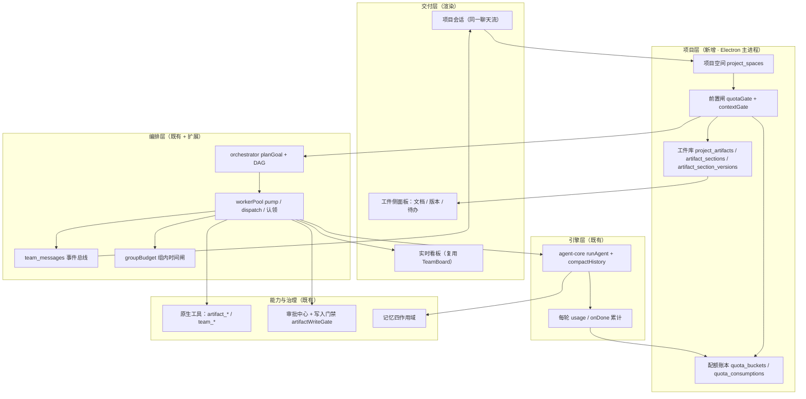
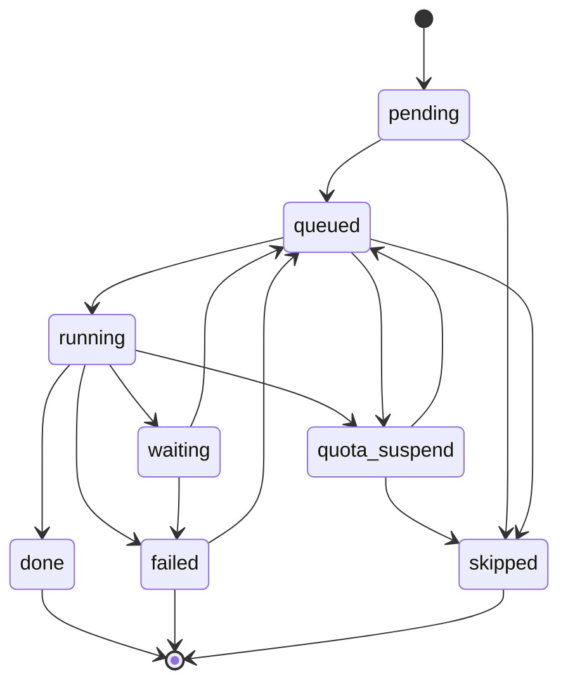
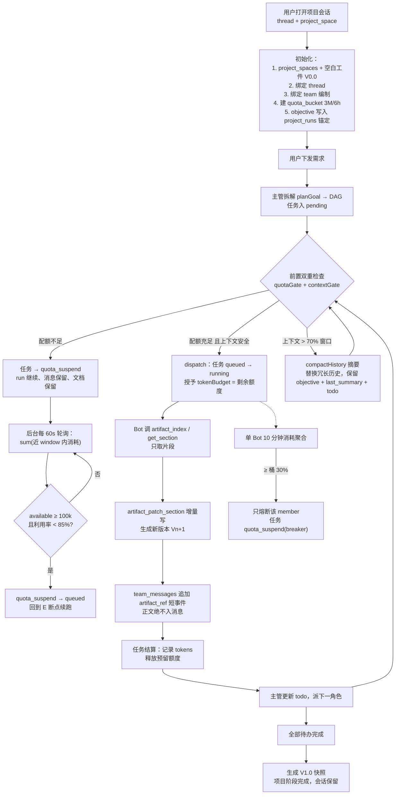
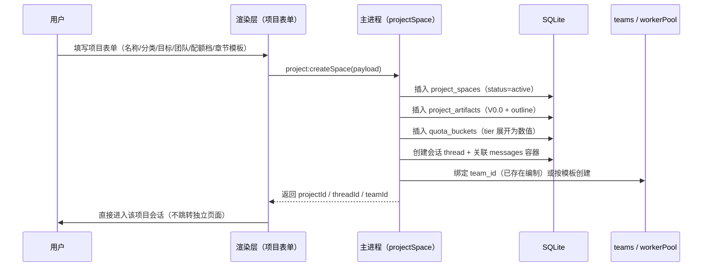
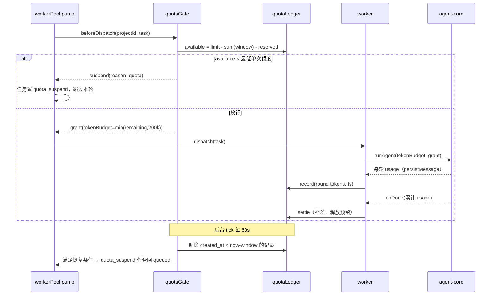

# MJCode · DS Bots 项目空间 / 工件 / 滑动配额协同设计（v1.0）

> **日期**：2026-10-22 ｜ **性质**：设计定稿（字段级 + 落点级），本轮**不改业务代码**
> **蓝本**：用户提供的 DS Bots 协同流程（单项目 = 单会话、多角色同会话、工件与消息解耦、滑动配额断点续跑）
> **原则**：不重写引擎 · 不新增进程 · 不建第二套存储 · 权限不降级 · 原生优先
> **上游文档**：[MJ 军团团队层设计逻辑 v1.5](file:///Users/jianma/Desktop/MJCode/MJCode-MJ军团团队层设计逻辑-v1-2026-10-20.md)、[GrokBot 与 DSBot 多 Agent 团队范式](file:///Users/jianma/Desktop/MJCode/MJCode-GrokBot与DSBot多Agent团队范式-调研与融入方案-2026-10-20.md)

---

## 0. 一句话结论

把这套流程装进 MJCode，**不是再造一个 DS Bots**，而是把用户蓝本里的五个抽象物映射到 MJCode 已有的五个等价物上：

| 蓝本抽象物 | MJCode 等价物（已存在） | 本设计要做的事 |
|---|---|---|
| DSH Session（一个会话） | 对话 thread（`conversations` / `messages`） | 新增「项目空间」把 thread 与工作目录、目标、团队、配额显式绑定 |
| 会话内多 Bot | `teams` / `team_members` + `workerPool` | 团队复用，新增每项目绑定一个编制 |
| Bot 协作与调度 | `orchestrator`（planGoal + DAG）+ `workerPool` + `team_messages` | 扩展一个非终态 `quota_suspend` + 调度前置闸 |
| 工件仓库（文档版本库） | **缺失** | 新增 `project_artifacts` 四表 + 4 个原生工具 |
| 滑动配额桶 | `groupBudget`（仅组内 token 软告警 + 墙钟硬闸） | 新增项目级滑动窗口账本（跨 run / 跨天），`groupBudget` 保留为内层时间闸 |

**两个超限必须分开处理**（这是用户原始方案里最关键的一条，也是本设计的核心不变量）：

- **上下文超限**（模型窗口）→ 压缩/摘要，**不暂停任务**；
- **配额超限**（花钱额度）→ 暂停新推理，**不删文档、不删任务、不删消息、不删会话**，靠滑动老化自动续跑。

---

## 1. 现状基线（真实代码取证）

### 1.1 已有能力

| 能力 | 现状 | 取证 |
|---|---|---|
| 任务 DAG 编排 | `planGoal` 拆解 + `validateDag` 校验（任务数/依赖/环） | [orchestrator/index.js](file:///Users/jianma/Desktop/MJCode/desktop/main/orchestrator/index.js)、[dag.js](file:///Users/jianma/Desktop/MJCode/desktop/main/orchestrator/dag.js) |
| 任务状态机 | `pending → queued → running → done / failed / skipped`，另有运行期 `waiting` | [taskStore.js](file:///Users/jianma/Desktop/MJCode/desktop/main/taskStore.js#L9-L23) |
| 并发与调度 | 信号量并发（默认 4 / 上限 8）+ 波次串行 + 探活撤员 | [workerPool.js](file:///Users/jianma/Desktop/MJCode/desktop/main/workerPool.js#L180-L260)、[waveEngine.js](file:///Users/jianma/Desktop/MJCode/desktop/main/waveEngine.js) |
| 组级预算 | `max_rounds` 硬、`max_wall_ms` 硬、`max_tokens` **软告警** | [groupBudget.js](file:///Users/jianma/Desktop/MJCode/desktop/main/groupBudget.js#L92-L160) |
| 团队编制与消息总线 | `teams` / `team_members` / `team_messages`（kind 已含 `artifact_ref`） | [teamStore.js](file:///Users/jianma/Desktop/MJCode/desktop/main/teamStore.js#L43)、迁移 v8/v9 |
| 团队记忆 | 四作用域 `session/team/project/global` | [teamStore.js](file:///Users/jianma/Desktop/MJCode/desktop/main/teamStore.js)、迁移 v11 |
| 会话内协同 UI | 团队运行卡（折叠/展开）+ 实时看板 | [TeamRunStream.tsx](file:///Users/jianma/Desktop/MJCode/desktop/renderer/src/components/TeamRunStream.tsx)、[TeamBoard.tsx](file:///Users/jianma/Desktop/MJCode/desktop/renderer/src/components/TeamBoard.tsx) |
| 上下文压缩 | `compactHistory` 按窗口比例触发，保留前导 system + 首条 user，摘要回写消息链 | [agent-core/index.js](file:///Users/jianma/Desktop/MJCode/desktop/agent-core/index.js#L1375-L1500) |
| 引擎 token 预算 | 单任务 `tokenBudget` 由宿主传入，引擎内部兜底 | [agent-core/cli.js](file:///Users/jianma/Desktop/MJCode/desktop/agent-core/cli.js#L276)、[agent-core/index.js](file:///Users/jianma/Desktop/MJCode/desktop/agent-core/index.js#L2428) |
| 每轮用量上报 | 引擎每轮 `persistMessage` 落 `tokens_input/tokens_output`，结束时 `onDone` 回累计 `usage` | [agent-core/index.js](file:///Users/jianma/Desktop/MJCode/desktop/agent-core/index.js#L3415)、[agentRunner.js](file:///Users/jianma/Desktop/MJCode/desktop/main/agentRunner.js#L441-L477) |
| 隔离工作区 | 每任务可建 git worktree，分支前缀 `mjcode/` | [worktree.js](file:///Users/jianma/Desktop/MJCode/desktop/main/worktree.js#L9-L89) |
| 迁移链 | 已到 **v13**，下一版为 v14 | [db/index.js](file:///Users/jianma/Desktop/MJCode/desktop/main/db/index.js#L339-L360) |

### 1.2 三个真实缺口

1. **没有「项目」实体**。当前只有 `cwd`（工作目录）与会话，二者靠 `task_groups.thread_id / project_path` 弱关联；没有地方挂「固定目标 / 配额桶 / 工件库」。
2. **没有跨 run 的成本账本**。`groupBudget` 只在一个 run 内有效，run 结束即 `clear`，无法回答「这个项目过去 6 小时花了多少」。
3. **没有工件层**。长文档只能进消息或写工作区文件，前者爆上下文、后者污染代码仓库且无版本语义。

---

## 2. 目标与非目标

### 2.1 目标（v1 必达）

1. 一个项目 = **一个会话（thread）+ 一个工作目录（可选）+ 一个固定目标 + 一套 Bot 编制 + 一个独立滑动配额桶**。
2. 所有角色在**同一个会话消息流**内协作，不新开独立 Bot 会话。
3. 完整文档存储于工件库，模型通过工具**按片段读写**，消息流只出现短事件与引用。
4. 派发前做**双重前置检查**（配额 / 上下文），两种超限分别处理。
5. 配额耗尽 → `quota_suspend` 排队 → 老化释放 → **自动断点续跑**，无需用户重述需求。
6. 单 Bot 异常消耗可**单独熔断**，不影响同会话其他成员。
7. 跨天迭代只加载「固定目标 + 最新摘要 + 待办 + 目标章节」，不重放全部历史。

### 2.2 非目标（明确不做）

| 非目标 | 原因 |
|---|---|
| 独立群聊页 / 多 Tab 分屏 | v1.5 已定案：团队嵌入当前对话；分屏会制造第二套消息视图 |
| 每个 Bot 独立 Session | 跨会话记忆割裂、配额分散、断点无法统一，直接否决 |
| 管理员授信后台 | v1 只做「用户手动追加额度」；后台体系另立项 |
| 7 天闲置自动归档 | 与「团队永久保留」的用户口径冲突，v1 只记录闲置时长，不自动冻结 |
| 把完整 PRD 注入 system | 与工件层设计冲突，明文禁止 |

---

## 3. 总体架构



**分层不变量**

| # | 不变量 | 落点 |
|---|---|---|
| I1 | 配额判定只在 `quotaGate` 一处，其他模块不得重复判断 | 单一事实来源，防规则漂移 |
| I2 | 工件正文永不进入 `messages` / `team_messages.summary` | 超限拒绝 + 只允许 refs |
| I3 | 暂停不是失败：`quota_suspend` 非终态，文档/任务/消息一律保留 | 状态机 + pump 收尾守卫 |
| I4 | 上下文压缩不改任务状态，只改消息链 | `compactHistory` 既有语义 |
| I5 | 团队不是权限容器：成员仍走 rolePreset + 审批 + 沙箱 | 权限不降级 |

---

## 4. 领域模型与存储（迁移 v14）

> 全部新增表，不改既有表结构；唯一对既有表的改动是 `sub_tasks.status` 允许新值（TEXT，无 CHECK 约束，无需迁移 DDL）。

### 4.1 `project_spaces` — 项目空间

| 字段 | 类型 | 约束 | 说明 |
|---|---|---|---|
| `project_id` | TEXT | PK | `prj_<ulid>` |
| `name` | TEXT | NOT NULL | 项目名，同时作为会话标题 |
| `category` | TEXT | NOT NULL | `prd` / `tech` / `marketing` / `custom`（决定默认章节模板） |
| `objective` | TEXT | NOT NULL | **固定全局目标与约束**，每次装配必然注入，摘要时永久保留 |
| `cwd` | TEXT | NULL | 工作目录；空 = 自建目录（遵守既有「不默认绑定固定工作区」约束） |
| `thread_id` | TEXT | UNIQUE | 绑定的会话；一个 thread 只能属于一个项目空间 |
| `team_id` | TEXT | NULL FK→`teams.id` | 绑定编制；空 = 尚未招募 |
| `artifact_id` | TEXT | NULL FK→`project_artifacts.id` | 主工件（一个项目空间 v1 只支持一个主文档） |
| `status` | TEXT | NOT NULL | `active` / `paused` / `completed`（阶段完成不销毁） |
| `meta_json` | TEXT | | `{last_summary, last_summary_at, last_active_at, theme}` |
| `created_at` / `updated_at` | INTEGER | | |

> **为什么必须显式建表**：记忆归档曾因「拿临时工作目录当空间键」导致项目级记忆无法召回。项目身份必须由稳定 ID 承载，不能用 cwd 或 thread 临时值替代。

### 4.2 `project_artifacts` — 工件（文档本体元信息）

| 字段 | 类型 | 说明 |
|---|---|---|
| `id` | TEXT PK | `art_<ulid>` |
| `project_id` | TEXT FK | |
| `kind` | TEXT | `document` / `spec` / `plan` / `custom` |
| `title` | TEXT | |
| `outline_json` | TEXT | 章节树 `[{key,title,order,level}]`，模型索引的唯一来源 |
| `current_version` | TEXT | `V0.0` 起步，形如 `V0.12`（两位序号，便于排序） |
| `snapshot_policy` | TEXT | `per_patch`（默认）/ `per_stage` / `manual` |
| `retain_versions` | INTEGER | 默认 10，超出归档到 `artifact_versions_archive`（同表加 `archived` 位即可，不另建表） |
| `size_bytes` | INTEGER | 全工件字节数，写前校验 |
| `created_at` / `updated_at` | INTEGER | |

### 4.3 `artifact_sections` — 当前章节内容（唯一"最新值"）

| 字段 | 类型 | 说明 |
|---|---|---|
| `artifact_id` | TEXT | 联合 PK |
| `section_key` | TEXT | 联合 PK；`root` 保留给索引/摘要，`__outline__` 保留给大纲 |
| `title` | TEXT | |
| `content` | TEXT | 当前正文 |
| `version` | TEXT | 最近一次写入的版本 |
| `updated_by` | TEXT | member_id / `user` |
| `updated_at` | INTEGER | |

### 4.4 `artifact_section_versions` — 章节历史（增量快照）

| 字段 | 类型 | 说明 |
|---|---|---|
| `id` | INTEGER PK AUTOINCREMENT | |
| `artifact_id` / `section_key` / `version` | TEXT | 联合唯一索引 |
| `content` | TEXT | 该版本写入的**完整章节内容**（只存变更章节，不做全量复制） |
| `change_summary` | TEXT | 模型给出的 ≤ 200 字变更说明 |
| `author_member_id` / `run_id` | TEXT | 归属 |
| `created_at` | INTEGER | |

**版本读取语义**：`get_section(key, version=Vn)` = 在 `artifact_section_versions` 中取「`version ≤ Vn` 且 `section_key=key` 的最新一行」；没有历史行则取 `artifact_sections` 当前值。这样 `V1.0` 可由增量行完整重建，不需要存 10 份全文。

### 4.5 `quota_buckets` — 项目级配额配置

| 字段 | 类型 | 说明 |
|---|---|---|
| `project_id` | TEXT PK | 一项目一桶，**拒绝全局共享桶** |
| `total_limit` | INTEGER | 默认 3,000,000 |
| `window_seconds` | INTEGER | 默认 21,600（6h） |
| `warn_ratio` | REAL | 0.70 |
| `throttle_ratio` | REAL | 0.90 |
| `resume_min_tokens` | INTEGER | 100,000（恢复下限） |
| `resume_hysteresis_ratio` | REAL | 0.85（回落到该水位以下才恢复，防抖动） |
| `tier` | TEXT | `light` / `standard` / `large` / `custom` |
| `created_at` / `updated_at` | INTEGER | |

### 4.6 `quota_consumptions` — 扣费流水（滑动窗口唯一数据源）

| 字段 | 类型 | 说明 |
|---|---|---|
| `id` | INTEGER PK AUTOINCREMENT | |
| `project_id` | TEXT | |
| `run_id` / `task_id` / `member_id` | TEXT | `member_id` 用于单 Bot 熔断 |
| `tokens` | INTEGER | 实际消耗（输入 + 输出） |
| `source` | TEXT | `round`（每轮）/ `settle`（任务结算补差）/ `manual_grant`（授信） |
| `created_at` | INTEGER | 扣费时间戳，老化判据 |

索引：`(project_id, created_at)`、`(project_id, member_id, created_at)`。

> **不再新增 breaker 表**：单 Bot 熔断状态由 `quota_consumptions` 的 10 分钟窗口实时聚合得出（同一事实来源），重启后自然恢复，不产生额外持久态。

### 4.7 `project_runs` — run 与项目的关联及摘要

| 字段 | 类型 | 说明 |
|---|---|---|
| `run_id` | TEXT PK | 复用 `task_groups.group_id` |
| `project_id` | TEXT | |
| `thread_id` | TEXT | |
| `quota_state` | TEXT | `ok` / `throttled` / `suspended`（展示与恢复用） |
| `summary_json` | TEXT | `{done:[], version, todo:[], disputes:[]}` 结构化摘要 |
| `summary_at` | INTEGER | |
| `created_at` / `updated_at` | INTEGER | |

> `project_runs` 是「跨天迭代」的加载入口之一，**不替代** `task_groups` 与 `team_messages`。

---

## 5. 状态机

### 5.1 任务状态（新增一个非终态）



**迁移表改动（taskStore）**

```js
quota_suspend: ['queued', 'skipped'],   // 恢复唯一入口=queued；取消=skipped
queued:        [..., 'quota_suspend'],  // 派发前被闸拦下
running:       [..., 'quota_suspend'],  // 运行中余额跌破 0 的兜底（仅限「本轮结束、不再起新一轮」）
```

**必须同步修改的点**（漏一处即出现假绿）：

| 位置 | 改动 |
|---|---|
| `TERMINAL_TASK_STATUSES` | **不加入** `quota_suspend`（非终态） |
| `pump` 收尾判定 | 存在 `quota_suspend` 任务时**禁止** `finalizeGroup`，否则组会被误判完成 |
| `dependencyCascade` | `quota_suspend` 不触发下游 skipped（依赖只认 done/skipped） |
| `teamStream` 投影 | 新增状态标签与计数分组 |
| `TeamBoard` 五列 | 新增「配额暂停」列，或并入「待开始」并加角标（推荐独立列） |
| `teamLabels.mjs` / i18n | `quota_suspend` 双语文案 |
| `workerPool.abortGroup` | 可中止 `quota_suspend` 任务 |

### 5.2 run / 项目状态

- run（`task_groups.status`）**不新增枚举**：暂停期间保持 `running`，由 `project_runs.quota_state` 表达成本状态，避免与既有 `paused`（关键任务失败暂停）语义混用。
- 项目空间 `status`：`active → completed` 仅在所有待办完成时由主管显式置位；`paused` 仅在用户手动暂停时使用。

### 5.3 单 Bot 熔断状态

| 状态 | 判据 | 动作 |
|---|---|---|
| `closed` | 10 分钟窗口内该成员消耗 < 桶总量 30% | 正常派发 |
| `open` | ≥ 30% 且 ≥ 100k tokens | 该成员新任务全部 `quota_suspend(reason=breaker)`，其他成员不受影响 |
| `half_open` | 熔断持续满 10 分钟后重新聚合 | 熔断窗口内首笔消耗回落阈值下 → 放行一个任务；再超限 → 重新 `open` |

---

## 6. 主流程

### 6.1 全链路（对应你原始流程图，节点已落到 MJCode 实现）



### 6.2 初始化时序



### 6.3 配额暂停 → 恢复时序（断点续跑核心）



### 6.4 跨天迭代

1. 用户回到同一项目会话，输入「订单模块增加退款售后」。
2. 装配上下文（**只加载四项**）：`project_spaces.objective` + `project_runs.summary_json` + 未完成 `sub_tasks` + `artifact.outline_json`。
3. 主管拆解 → 目标 Bot 先 `artifact_get_section('order')`（≤ 8000 字符），**不加载全文、不重放历史**。
4. 写完 `artifact_patch_section('order', base_version=V0.12)` → 生成 `V0.13`。
5. 消息流只追加一条 `artifact_ref` 事件。

---

## 7. 双重前置检查的精确落点

### 7.1 检查点

| 时机 | 检查 | 落点 | 不通过时 |
|---|---|---|---|
| 派发每个任务前 | 配额 + 上下文 | `workerPool.pump` 内、`dispatch` 之前 | 任务 `quota_suspend` / 触发压缩后重试 |
| 任务开跑前 | 配额（预留授予） | `runWorkerTask` 装配 `runOpts` 处 | 释放信号量、任务回 `quota_suspend` |
| 引擎每轮 | 配额（软守卫） | `tokenBudget` 夹到剩余额度 + `onBudget` trace 观测 | 不再起新一轮，正常收尾 |
| 任务结束 | 结算 | `runWorkerTask` 的 `finally` | 写 `quota_consumptions`、释放预留 |

> **不在模型侧做判断**：所有闸门必须确定性代码判定，不接受「模型说额度够」。

### 7.2 两级额度的关系（不要混）

| 层 | 字段 | 语义 | 超限后果 |
|---|---|---|---|
| 项目配额（新增） | `quota_buckets.total_limit` / `window_seconds` | 跨 run 的成本额度，滑动老化 | 暂停新推理，**任务保留** |
| 组预算（既有） | `budget_json.max_tokens` | 单次派活的成本信封，软告警 | 只告警，继续执行 |
| 组预算（既有） | `max_wall_ms` / `max_rounds` | 单次派活的硬闸 | 到点停派 / 引擎停轮 |

派发时 `tokenBudget = min(项目剩余额度, 组剩余额度, 默认 200k)`。

---

## 8. 配额账本算法

### 8.1 数据结构与口径

```text
available(projectId, now) =
    total_limit
  - Σ quota_consumptions.tokens
      WHERE project_id = ? AND created_at > now - window_seconds
  - Σ reserved（内存态：已授予但尚未结算的在途 tokenBudget）
```

- **只统计窗口内**：老记录自然不参与，无需删除，也无需定时任务改写额度。
- **记录永不删**（保留审计）；老化是「查询口径」而不是「数据操作」。
- **预留**防超发：并发任务共享同一桶时，授予即扣预留，结算时释放并写入实际值。

### 8.2 伪代码（单一事实来源）

```js
// quotaLedger.js —— 唯一判定入口
function available(projectId, now = Date.now()) {
  const b = bucketOf(projectId);
  const used = db.sumTokens(projectId, now - b.window_seconds * 1000);
  return Math.max(0, b.total_limit - used - reservedOf(projectId));
}

function beforeDispatch(projectId, task) {
  const b = bucketOf(projectId);
  const avail = available(projectId);
  const min = Math.max(b.resume_min_tokens, 1000);
  if (avail < min) return { allow: false, reason: 'quota', state: 'suspended' };
  if (avail < b.total_limit * (1 - b.throttle_ratio)) return { allow: false, reason: 'throttle' };
  return { allow: true, grant: Math.min(avail, 200000) };
}

function settle(projectId, runId, taskId, memberId, granted, actual) {
  reservedOf.release(taskId);
  const delta = Math.max(0, actual - recordedRoundsOf(taskId));
  if (delta > 0) db.insertConsumption({ projectId, runId, taskId, memberId, tokens: delta, source: 'settle' });
}

function tick(projectId) {
  const b = bucketOf(projectId);
  const avail = available(projectId);
  const util = 1 - avail / b.total_limit;
  if (avail >= b.resume_min_tokens && util < b.resume_hysteresis_ratio) {
    store.resumeSuspendedTasks(projectId, { limit: 2 }); // 小批量恢复，防瞬间再次打满
  }
}
```

### 8.3 三档水位

| 水位 | 判定 | 动作 |
|---|---|---|
| 70% | `used ≥ 0.7 × limit` | 一次性告警事件（写 run 卡），不阻断 |
| 90% | `used ≥ 0.9 × limit` | 限流：只允许「增量 patch / 问答」类任务；拒绝标记为 `full_rewrite` 的任务 |
| 100% | `used ≥ limit` 或无最低额度 | 熔断：新任务全部 `quota_suspend`，在途任务跑完 |

### 8.4 老化示例（与用户口径一致）

| 时刻 | 新增 | 窗口内累计 | 状态 |
|---|---|---|---|
| 0h | 1.0M | 1.0M | ok |
| 1h | 1.2M | 2.2M | ok |
| 2h | 0.9M | 3.1M | **suspended** |
| 6h+10m | 0 | 2.1M（0h 那笔老化） | available=0.9M → 自动恢复 |

### 8.5 边界规则

| 场景 | 规则 |
|---|---|
| 用户手动追加额度 | 写一条 `source='manual_grant'` 的**负值**记录？**禁止**。改为提升 `total_limit` 并写 `quota_grant_events`（审计），不污染消耗流水 |
| 系统时钟回拨 | 查询用 `now`，写入用 `Date.now()`；若检测到 `now < max(created_at)`，以 max 为基准，避免额度凭空恢复 |
| 并发任务同抢 | 预留是内存单线程操作（主进程），无竞态；进程重启后预留归零，可能短暂超发 ≤ 一个任务预算，可接受 |
| 恢复抖动 | 必须有迟滞（85%），否则「恢复→立刻打满→再暂停」循环 |
| 团队预算与项目配额冲突 | 项目配额优先；组预算只在两者都充足时生效 |

---

## 9. 工件层（最关键的工程接口）

### 9.1 工具契约（4 个，全部原生，禁止走 MCP）

| 工具 | 入参 | 返回 | 上限 |
|---|---|---|---|
| `artifact_index` | `project_id?` | 章节树 + 当前版本 + 各章节字数 + 最近变更 | ≤ 1.2k tokens |
| `artifact_get_section` | `section_key`, `version?`, `offset?`, `max_chars?` | 片段正文 + `truncated/next_offset` | 单次 ≤ 8000 字符 |
| `artifact_patch_section` | `section_key`, `content`, `base_version`, `change_summary` | `{version, chars, section}` **不返回全文** | content ≤ 16000 字符 |
| `artifact_get_diff` | `from_version`, `to_version`, `section_key?` | 行级 diff（截断） | ≤ 4000 字符 |

**为什么是 4 个而不是 3 个**：`artifact_index` 是「防 token 爆炸」的前置索引——没有它，模型只能靠试错猜 section_key，或先拉全文。它是低成本索引，不是额外能力。

### 9.2 `patch_section` 的确定性语义

1. 校验 `section_key` 在 `outline_json` 中存在（不存在 → `SECTION_NOT_FOUND` + 可用 key 列表）。
2. 校验 `base_version === current_version`；不等 → `VERSION_CONFLICT`，返回冲突章节的短 diff 与当前版本号。
3. 校验体积（单章节 ≤ 64KB、全工件 ≤ 2MB、patch ≤ 16000 字符）。
4. 事务内：写 `artifact_sections` + 写 `artifact_section_versions` + `current_version + 0.01`。
5. 按 `snapshot_policy` 决定是否额外生成「阶段快照」（`per_stage` 时由主管显式调用 `artifact_snapshot`；v1 先不做该工具，`per_stage` 暂等同 `per_patch`）。
6. 返回短回执；**同时由宿主**（不是模型）向 `team_messages` 写一条 `kind='artifact_ref'` 事件。

> 模型不得自行决定「要不要记一条消息」——事件由工具 handler 统一产生，保证消息流一致。

### 9.3 正文绝不入消息的三道闸

| 闸 | 位置 | 规则 |
|---|---|---|
| 工具返回闸 | `artifactWriteGate` 复用 | 返回体超限截断并标注 |
| 消息写入闸 | `teamStore.appendMessage` | `summary` > 4000B 拒绝；`payload_json` 体积校验；正文关键词检测（连续 > 800 字符同段）拒绝 |
| UI 渲染闸 | `TeamRunStream` / `ChatArea` | 只渲染摘要与引用卡，不展开正文 |

### 9.4 版本与存储成本

- 只对**变更章节**存历史行 → 10 个版本 × 5 个章节变更 ≈ 50 行，远小于 10 份全文。
- 超过 `retain_versions` 的版本行置 `archived=1`（不删，可恢复），查询默认过滤。
- 全量导出（Markdown/PDF）走既有文档原生工具，不经过消息链。

---

## 10. 上下文经济性

### 10.1 装配预算（每次 run 起跑时的固定开销）

| 块 | 预算 | 来源 |
|---|---|---|
| 固定目标 objective | ≤ 800 字符 | `project_spaces.objective`，**永不压缩** |
| 最新摘要 last_summary | ≤ 1500 字符 | `project_runs.summary_json` |
| 待办 todo | ≤ 40 条（每条 ≤ 120 字符） | `sub_tasks` 未终态 |
| 工件索引 | ≤ 1.2k tokens | `artifact_index` |
| 团队共享记忆 | 既有容量闸（10 条） | `memories(scope='team')` |
| 成员角色提示词 | 既有 | `team_members.system_prompt` |

**硬规则**：工件正文不在这张表里——它只能由工具按需读取。

### 10.2 摘要压缩（复用，不新建）

| 项 | 值 | 说明 |
|---|---|---|
| 触发 | 窗口 70% | `compactPolicy.triggerRatio` 既有默认 |
| 激进档 | 85% | 尾部保留区缩小 |
| 摘要模型 | `modelOverrides.compact` | 既有分档能力 |
| 保留 | 前导 system（含 objective）+ 首条 user + 尾部 N% | 既有 `withHead` 语义 |
| 落库 | `project_runs.summary_json` + 既有 `memory_saved` 事件 | 不新增第二套摘要存储 |
| 失败兜底 | 受控裁剪（始终保留 objective/summary/todo） | 不允许「裁掉目标」 |

### 10.3 消息流预算

- 每个任务结束**最多产生 1 条** Bot 事件 + 1 条 `artifact_ref`（若写工件）+ 1 条系统事件（若压缩/暂停）。
- 禁止把工具入参、全文、完整 diff 写进消息。
- 团队卡默认折叠，展开才拉轨迹（既有行为）。

---

## 11. 项目创建表单 → 初始化映射

### 11.1 字段清单（前端）

| 分组 | 字段 | 类型 | 必填 | 校验 / 默认 | 落库 |
|---|---|---|---|---|---|
| 基础 | 项目名称 | 文本 | 是 | 1–40 字符，同 thread 内唯一 | `project_spaces.name` |
| 基础 | 项目分类 | 下拉 | 是 | `产品PRD / 技术方案 / 营销策划 / 自定义` | `category` |
| 基础 | 全局目标与约束 | 多行 | 是 | 20–2000 字符（必填原因见下） | `objective` |
| 基础 | 工作目录 | 下拉 | 否 | 候选=最近打开项目（按 `lastOpenedAt` 倒序），留空=自建目录 | `cwd` |
| 团队 | 团队模板 | 下拉 | 是 | `产品PRD协作 / 技术评审 / 营销策划 / 自定义 / 现有团队` | `team_id` |
| 团队 | 角色清单 | 动态表 | 模板时只读 | 每行：名称/职责/模型/启用熔断 | `team_members` |
| 配额 | 档位 | 下拉 | 是 | 轻量 1M/2h、标准 3M/6h（默认）、大型 10M/24h、自定义 | `quota_buckets` |
| 工件 | 工件类型 | 下拉 | 是 | 文档 / 方案 / 策划案 / 自定义 | `project_artifacts.kind` |
| 工件 | 默认章节 | 文本域 | 否 | 按分类带默认值，可编辑 | `outline_json` |
| 工件 | 快照规则 | 单选 | 是 | 每轮修改（默认）/ 每阶段 / 手动 | `snapshot_policy` |
| 工件 | 保留版本数 | 数字 | 是 | 1–50，默认 10 | `retain_versions` |
| 高级 | 摘要触发阈值 | 数字 | 否 | 默认 70%，夹 50–85% | `compactPolicy` |
| 高级 | 断点续跑 | 开关 | 否 | 默认开 | `quota_buckets.resume_*` |

**必填校验必须是内联反馈**：历史事故（团队创建点「创建」无反应）源于错误只写页面级、被 Modal 遮住；本项目表单同样要求字段级红字 + 提交按钮禁用态。

### 11.2 模板 → 角色（复用既有 rolePreset，不新建身份体系）

| 模板 | 角色 | 对应 rolePreset |
|---|---|---|
| 产品 PRD 协作 | PM / 后端 / 前端 / UI 设计 | 既有产品、研发、设计预设 |
| 技术方案评审 | 架构 / 后端 / 测试 / 运维 | 研发类预设 |
| 营销活动策划 | 策划 / 文案 / 投放 / 风控 | 自定义描述（生成后**人审落库**） |
| 现有团队 | 直接绑定 `team_id` | — |

### 11.3 提交后初始化顺序（事务边界）

1. `project_spaces`（含 objective）→ 2. `project_artifacts`（V0.0 + outline）→ 3. `quota_buckets` → 4. thread 创建/绑定 → 5. 团队绑定或按模板创建 → 6. 写入首条系统消息「项目已创建，目标已锁定」 → 7. 返回并进入会话。

任一步失败 → 整体回滚，不留下「半初始化项目」。

---

## 12. UI 形态

### 12.1 一个会话，不新增页面

| 区域 | 内容 | 复用/新增 |
|---|---|---|
| 主聊天流 | 用户发言、各 Bot 事件、系统通知（配额暂停/恢复、版本生成、已压缩） | 复用 ChatArea + TeamRunStream |
| 运行卡 | 团队执行摘要、当前批次、预算条、配额状态徽标 | 扩展 TeamRunStream |
| 右侧面板（可隐藏） | 文档预览（只读当前版本）/ 版本快照列表 / 待办看板 | 新增 ArtifactPanel，看板复用 TeamBoard |
| 输入区 | `+` 菜单新增「项目」入口（选择/新建） | 扩展 Composer |

### 12.2 状态文案（中英双语必须同时登记）

| 状态 | zh-CN | en-US |
|---|---|---|
| 配额暂停 | 配额暂停，等待额度恢复 | Quota paused, waiting for budget |
| 已自动压缩 | 历史已自动摘要压缩 | History auto-compacted |
| 版本生成 | 已生成 V{n} | Generated V{n} |
| 单成员熔断 | 成员消耗异常，已单独暂停 | Member suspended for abnormal usage |
| 上下文超限 | 上下文超限，已压缩 | Context limit reached, compacted |

### 12.3 视觉约束

- 不新增全屏页；侧面板默认收起，首次生成工件后自动展开一次。
- 不使用 emoji；状态用文字 + 色点（灰=正常、琥珀=限流、红=暂停）。
- 深色主题下文字/图标灰白，遵守既有主题规范。

---

## 13. 断点续跑与崩溃恢复

| 场景 | 恢复动作 |
|---|---|
| 配额暂停后恢复 | `quota_suspend → queued`，按 `seq` 重新派发；不重跑已完成任务 |
| 应用重启 | 内存预留清零；`running` 任务按既有崩溃恢复回 `queued`；`quota_suspend` 原样保留 |
| 摘要压缩后重启 | `summary_json` 已落库，装配时直接使用；原始消息仍在库中可审计 |
| 工件写入中断 | patch 在单事务内完成；中断即无版本产生，`current_version` 不变 |
| 版本冲突 | 返回 `VERSION_CONFLICT` + diff；模型重读后再 patch，不自动覆盖 |
| 单 Bot 熔断后重启 | 由 `quota_consumptions` 重新聚合，10 分钟内仍超限则继续熔断 |

---

## 14. 治理与安全

| 项 | 规则 |
|---|---|
| 权限 | 工件工具只写 `project_artifacts` 库，**不直接写工作区文件**；工作区改动仍走 worktree + 审批 |
| 审批分级 | `artifact_patch_section` L1（可撤销、限项目内）；`artifact_get_*` 只读免审批 |
| 审计 | 每次 patch 写 `artifact_section_versions` + 既有工具审计（含 member/run/耗时/字节数） |
| 工具登记 | 新增 4 个工具必须走既有 8 环节：引擎 schema、审批透传、handler 映射、超时配置、主进程接线、审批分级、可补偿性、UI 轨迹标签 + 双语 i18n |
| 体积攻击 | content 上限 + 全工件上限 + 消息写入闸三层 |
| 越权读取 | `project_id` 必须来自当前会话绑定，禁止模型传入任意 project_id 读他人项目 |
| MCP | 工件能力为原生工具，**不登记 MCP**；原生优先原则 |

---

## 15. 落地拆解（T6 系列）

| ID | 任务 | 依赖 | 验收要点 |
|---|---|---|---|
| T6-1 | 迁移 v14（6 张表 + 索引） | — | 迁移幂等；旧库升级后 `user_version=14` |
| T6-2 | 项目空间仓储 + IPC（create/list/get/updateStatus） | T6-1 | 事务回滚；thread 唯一约束 |
| T6-3 | 配额账本（available/grant/settle/tick/resume） | T6-1 | 单元测试覆盖老化、预留、迟滞、时钟回拨 |
| T6-4 | 任务状态扩展 `quota_suspend` + pump 守卫 + 依赖/收尾/看板/流投影 | T6-3 | 状态迁移合法；未终态不被 finalize；14 处接线无遗漏 |
| T6-5 | 工件仓储 + 版本重建 + 并发控制 | T6-1 | `Vn` 片段读取正确；冲突返回 409 语义 |
| T6-6 | 4 个原生工具 + 8 环节接线 + 体积闸 | T6-5 | 工具登记矩阵双向差集断言；正文不入消息 |
| T6-7 | 前置双检接入 workerPool（pump / 装配 / 结算） | T6-3/T6-4 | 暂停不派发、恢复自动续跑 |
| T6-8 | 单 Bot 熔断（聚合 + half-open） | T6-3 | 只锁单成员；其他成员继续 |
| T6-9 | 项目创建表单 + 初始化链路 + i18n | T6-2 | 内联校验；失败无脏数据 |
| T6-10 | 侧面板（文档/版本/待办）+ 运行卡配额徽标 | T6-6/T6-4 | 默认收起；双语文案齐全 |
| T6-11 | 上下文装配（objective + summary + todo + index） | T6-5 | 冷启动与跨天迭代只加载四项 |
| T6-12 | 端到端演练：3M/6h 打满 → 暂停 → 老化 → 续跑 | 全部 | 文档版本连续、任务不丢、无需重述需求 |

**门禁**：每完成一项必须过 `typecheck`、`lint`、单元测试、`doc-fact-check`、`harness-r7`；T6-4/T6-6 额外过「工具登记矩阵」与「i18n key 存在性」断言。

---

## 16. 风险与不采纳项

| 风险 | 影响 | 对策 |
|---|---|---|
| sql.js 整库序列化（150ms 防抖）遇高频扣费写入 | 性能抖动 | 扣费按轮合并写入（同一任务 500ms 聚合），不逐轮 flush |
| 摘要丢失关键约束 | 断点续跑跑偏 | objective 每轮无条件注入；摘要在系统提示词中单列「不可丢约束」字段 |
| `quota_suspend` 被误判终态 | 组提前收尾 | 收尾守卫 + 单测断言「存在非终态即不 finalize」 |
| 版本表膨胀 | DB 增大 | 增量章节存储 + 归档位 + 保留数上限 |
| 恢复瞬间再次打满 | 抖动 | 85% 迟滞 + 每轮最多恢复 2 个任务 |
| 模型绕过工件层直接写消息 | 上下文爆炸 | 写入闸 + 工具返回闸 + UI 不渲染正文 |
| 项目表单字段过多 | 放弃创建 | 4 个必填 + 模板默认；高级项折叠 |
| 团队与项目绑死 | 复用受限 | `team_id` 可空，团队仍全局可用（v1.2 口径不回退） |

**不采纳**：独立 Bot 会话、全量文档入消息、整点清零配额、按人头切分配额（既有教训：成员被份额提前截停）、管理员后台、7 天自动归档。

---

## 17. 验收清单（可测）

- [ ] 一个项目只对应一个 thread；重复绑定被拒绝。
- [ ] 3M/6h 打满后：在途任务跑完、新任务全部 `quota_suspend`、run 卡显示暂停、文档版本不变。
- [ ] 最早一笔消耗满 6h 后，`available` 回升，暂停任务自动回 `queued` 并继续执行。
- [ ] 暂停与恢复过程中，会话消息、待办、工件、摘要均未丢失。
- [ ] 上下文达 70% 触发压缩，objective 仍在 system 中，任务状态不变。
- [ ] 工件 patch 后消息流只有 `artifact_ref` 摘要，无正文。
- [ ] `base_version` 过期时返回冲突，不产生静默覆盖。
- [ ] 单成员 10 分钟消耗超 30% 被单独暂停，其他成员任务继续完成。
- [ ] 跨天回归：只加载 objective + summary + todo + outline，即可继续迭代。
- [ ] 全部新增 UI 文案中英齐全；无 emoji；深色主题正常。
- [ ] 新增 4 工具在 8 个环节全部登记，工具登记矩阵差集为空。

---

## 附录 A · 与你原始蓝本的逐节点映射

| 原始节点 | MJCode 落点 | 说明 |
|---|---|---|
| 创建 Project 记录 | `project_spaces` | 新增 |
| 新建空白 PRD 工件 V0.0 | `project_artifacts` + `artifact_sections('__outline__')` | 新增 |
| 创建 DSH Session | 既有 thread / conversations | 复用 |
| 注册 4 个角色 Bot | `teams` + `team_members` | 复用 |
| 绑定独立配额桶 | `quota_buckets` + `quota_consumptions` | 新增 |
| 写入固定锚定目标 | `project_spaces.objective` → 每次装配注入 | 新增 |
| 调度器分配任务 | `planGoal` + `taskStore.setTaskStatus` | 复用 |
| 前置双重检查 | `quotaGate.beforeDispatch` + `contextGate` | 新增 |
| 配额暂停 QUOTA_SUSPEND | `sub_tasks.status='quota_suspend'` | 新增状态 |
| 自动摘要子任务 | `compactHistory`（引擎内，不另起任务） | 复用 |
| artifact.get_section | `artifact_get_section` | 新增 |
| artifact.patch_section | `artifact_patch_section` | 新增 |
| 消息只追加简短事件 | `team_messages(kind='artifact_ref')` | 复用 + 强制 |
| 扣费记录带时间戳 | `quota_consumptions` | 新增 |
| 后台轮询老化 | `quotaLedger.tick`（每 60s） | 新增 |
| 断点续跑 | `quota_suspend → queued` | 新增 |
| 单 Bot 熔断 | 10 分钟聚合 + half-open | 新增 |
| 最终 V1.0 快照 | `artifact_versions`/`section_versions` + `project.status=completed` | 新增 |

## 附录 B · 为什么不用「每个 Bot 一个 Session」

| 维度 | 同一会话多成员（采纳） | 每 Bot 独立会话（否决） |
|---|---|---|
| 上下文 | 共享编排事件与摘要 | 互相看不见，需跨会话同步 |
| 配额 | 单桶可精确统计 | 多桶分散，暂停/恢复难以统一 |
| 断点 | 一个状态机 | N 个状态机 + 跨会话协调 |
| 工件 | 单写入序列，版本线性 | 并发写同文档，冲突不可控 |
| 体验 | 一个聊天流 | 用户需要在多个窗口切换 |

## 附录 C · 仓库分支现状答疑（工程侧，不属设计本体）

当前仓库共有 5 类分支，**不是版本号自动分裂**，来源各不相同：

| 分支 | 来源 | 说明 |
|---|---|---|
| `main` / `origin/main` | 主干 | 停在「Electron 升级前的版本备份」提交 |
| `feat/electron45`（当前） | 人工创建的功能分支 | Electron 33→45 + electron-builder 26 升级及后续修复 |
| `backup/electron33`（tag `v0.6.1-beta-e33-backup`） | 升级前**人工备份** | 与版本号有关，但只是一次性备份标签，不是自动机制 |
| `backup/remote-main-20261015` | 远程主干备份 | 发布清理前的快照，领先 2 / 落后 165 |
| `fix/harness-full-2026-10-18` | 修复分支 | harness 全量修复期产物 |
| `mjcode/worker-*`（10 个，带 worktree） | **MJCode 自身功能生成** | [worktree.js](file:///Users/jianma/Desktop/MJCode/desktop/main/worktree.js#L67-L89) 在每个 Worker 任务启动时 `git worktree add -b mjcode/<任务名>-<日期戳>`，任务结束未自动清理则残留 |

清理建议（**未执行，需你确认**）：只删已合并且无改动的 `mjcode/worker-*`；`backup/*` 与 `fix/*` 建议保留标签后归档。删除前先 `git worktree list` 确认目录为空改动。
