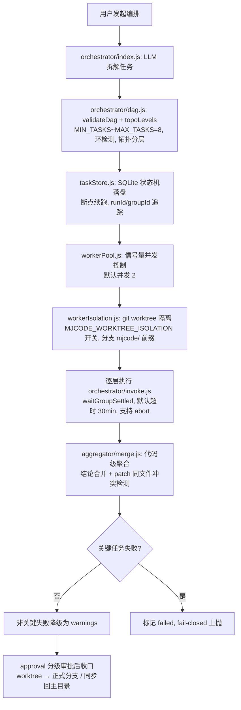

# Agent 产品实现流程与代码质量审查报告

> 审查范围：MJCode 项目中与 Agent 相关的产品链路（单 Agent 执行、多 Agent 编排、安全审批、隔离执行、测试门禁）。
> 审查方式：逐模块通读源码 + 实跑 `desktop` 全量测试（48 条测试命令）+ 文档与代码交叉比对。
> 日期：2026-10-14

---

## 一、Agent 产品实现流程（端到端）

### 1.1 单 Agent 执行链路

```
渲染层 lib/agent.js runAgent()
  → IPC 'agent:run'（runId + 参数，agentRunner.js:36，立即返回）
  → 主进程 agentRunner.initAgentRunner（main.js 注入点）在主进程跑 agent-core/index.js 的 runAgent 循环
      ├── 引擎：desktop/agent-core/index.js（1070 行，headless/ESM，零 Electron 依赖）
      │     ├── 工具循环：BASE_TOOLS 14 内置工具 + MCP + 自定义，maxRounds=40、硬轮次上限、token 预算闸
      │     ├── 上下文治理：estimateTokens(:207)、compactHistory(:232) 预判式压缩
      │     ├── 失败判定：isToolFailure(:654)——只认 ok===false / 显式 error（有意不熔断 exitCode≠0）
      │     └── 工具通道：toolHandlers 注入（渲染层映射 window.mjcode.* / 主进程直接执行）
      ├── 安全三闸：approval.js L1/L2/L3 分级 → approvalChannel.js 按 approvalId 精确分发应答
      │              writeGuard.js 写路径白名单 fail-closed；sandbox.js macOS Seatbelt + 跨平台硬拦截
      └── 事件回流：IPC 'agent:event'（{runId, type, data}：message/delta/tool_call/done/error）
  ← 中止：AbortSignal → IPC 'agent:abort' → 引擎优雅收尾
```

同一 headless 引擎被三处复用：渲染层交互、本地定时任务（scheduler）、云端 CLI（`agent-core/cli.js`，spawn + task.json → report.json，10 分钟超时）。

### 1.2 多 Agent 编排链路（审查重点，现有两份项目文档均未覆盖）



关键事实：

| 模块 | 文件（行数） | 职责 |
|---|---|---|
| 编排入口 | `main/orchestrator/index.js`（155） | LLM 拆解 → 校验 → 分层调度 |
| DAG 校验 | `main/orchestrator/dag.js`（107） | `MAX_TASKS=8`、环检测、拓扑分层 |
| 分组等待 | `main/orchestrator/invoke.js`（60） | `waitGroupSettled`，`DEFAULT_TIMEOUT_MS=30min` |
| 并发池 | `main/workerPool.js`（313） | 信号量，默认并发 2 |
| 状态机 | `main/taskStore.js`（195） | SQLite 持久化、断点续跑 |
| 结果聚合 | `main/aggregator/merge.js`（44） | 按任务拼接结论；同路径 patch 冲突检测；LLM 聚合模式延后 P2 |
| 运行壳 | `main/agentRunner.js`（141） | runId 生命周期 + 事件分发 + abort |

---

## 二、代码质量评估

### 2.1 优点（有据可查）

1. **引擎抽离干净**：`agent-core` 零 Electron 依赖，纯函数（`estimateTokens`/`isToolFailure`/`aggregateGroup`）均可单测；三处复用避免了三套循环逻辑。
2. **安全设计 fail-closed**：writeGuard 白名单默认拒绝；sandbox 跨平台硬拦截（`FALLBACK_DANGEROUS`）；审批 L1/L2/L3 分级且 approvalChannel 按 approvalId 精确分发，避免串扰。
3. **编排具备工程韧性**：taskStore 状态机支持断点续跑；invoke 有 30min 超时与 abort；merge 对多任务触碰同一文件的 patch 显式报冲突而非静默合并（merge.js:30-36）。
4. **测试是行为契约**：48 条命令覆盖 props-contract、undef-ident、tool-loop-guard、dag、orchestrator、workerPool、taskStore、approval、sandbox 等，断言边界行为而非实现细节。
5. **关键决策有注释解释"为什么"**：如 `isToolFailure` 故意不把 exitCode≠0 算失败，避免"改代码→跑测试→再改"循环被误熔断（index.js:650-653）。

### 2.2 问题与风险清单

| 级别 | 问题 | 位置 | 说明与建议 |
|---|---|---|---|
| **P0** | **文档与代码严重脱节：多 Agent 编排链路零覆盖** | `docs/project-logic.md`、`MJCode-项目审查与功能流程文档.md` | 两份文档均无 orchestrator/workerPool/taskStore/agentRunner/aggregator 任何字样，但这是产品核心卖点之一。需补一章「编排链路」。 |
| **P1** | 文档数据陈旧（7 处硬数字错误） | `docs/project-logic.md:29,30,46,50,54,95,361`；`MJCode-…文档.md:44,64,65` | 实际 vs 文档：main/ 模块 33 项 vs "20 个模块"；main.js 2489 行 vs "约 2000 / 2,059 行"；agent-core 1070 行 vs "约 840 / 836 行"；组件 35 vs "32 / 31 个"；测试 48 条命令（44 个文件）vs "35 套"。 |
| **P1** | `main.js` 单文件 2489 行、129 处 `ipcMain.handle/on` | `desktop/main/main.js` | 审查文档自己已建议按域拆分（`ipc/local.js`、`ipc/tools.js`…），至今未落地；合并冲突与审查成本持续累积。 |
| **P2** | Aggregator 仅代码级聚合，LLM 聚合模式未实现 | `aggregator/merge.js:3` | 注释自述"延后 P2"。跨任务语义缝合（如前后端契约一致性）目前缺失，冲突检测兜底靠从结果文本提取 patch 目标，可能误报/漏报。 |
| **P2** | `extractPatchTargetsFromText` 从自由文本反解 diff 目标 | `aggregator/merge.js:40-43` | 防御性补充可接受，但依赖模型输出格式稳定；建议对提取结果做路径合法性（writeGuard 白名单）二次过滤后再入冲突统计。 |
| **P2** | 测试对运行环境有隐性依赖 | `test/skillCompat.test.js:55`、`test/workerIsolation.test.js` | skillCompat 依赖系统 `TMPDIR` 可写；workerIsolation 依赖 `~/.mjcode/worktrees` 可写。受限环境（CI 沙箱/只读 home）下会失败且报错信息是底层 EPERM，不易定位。建议测试内自建可写根目录或对不可写环境 skip 并打印原因。 |
| **P3** | `agent-core` 单文件已达 1070 行 | `agent-core/index.js` | 工具循环、压缩、预算、runAgent 主体混在一个文件；可按 history/budget/tools 拆分，进一步提高可测性。 |

### 2.3 无发现问题的确认项

- `isToolFailure` 的"只认 ok===false/error"不是缺陷，是**有意设计且有注释**（见 2.1-5）。
- 编排链路的超时（30min）、并发（2）、任务数（2~8）、写路径（白名单）均有硬上限，无明显的失控风险。
- 未发现越权路径：所有工具写操作经 writeGuard 白名单，shell 经 sandbox 策略，审批经 approvalChannel 分发。

---

## 三、测试验证结果（本次实跑）

| 结果 | 说明 |
|---|---|
| 命令 | `cd desktop && TMPDIR=/tmp npm test`（串联 48 条测试命令，44 个测试文件） |
| 通过 | 47/48 套（含 agent-core、agent-engine、agentRunner、dag、orchestrator、workerPool、taskStore、aggregator、approval、sandbox、writeGuard、tool-loop-guard、render-smoke 等） |
| 失败 | `workerIsolation.test.js` 7 例，根因为**本审查沙箱禁止写 `~/.mjcode/worktrees/`**（`fatal: could not create leading directories … Operation not permitted`），逐例验证为环境权限问题，非代码缺陷 |
| 结论 | 代码在正常用户环境（home 可写）下测试门禁全绿；`npm test` 的 fail-fast 顺序导致其后 10 条命令未跑，已逐个单独补跑，全部 PASS |

---

## 四、整改建议（按优先级）

1. **补文档**：在 `docs/project-logic.md` 增加「多 Agent 编排链路」章节（可直接复用本报告 §1.2），并修正 7 处硬数字（模块数/行数/组件数/测试数）。
2. **拆 main.js**：按域拆分 IPC 注册，目标单文件 ≤800 行；`agent-core/index.js` 顺带按职责拆 3 个子模块。
3. **聚合器 P2**：实现 LLM 聚合模式，或至少给 `extractPatchTargetsFromText` 的输出套 writeGuard 白名单过滤。
4. **测试可移植性**：skillCompat/workerIsolation 对不可写环境做显式 skip + 中文提示，避免 CI 中出现裸 EPERM。
