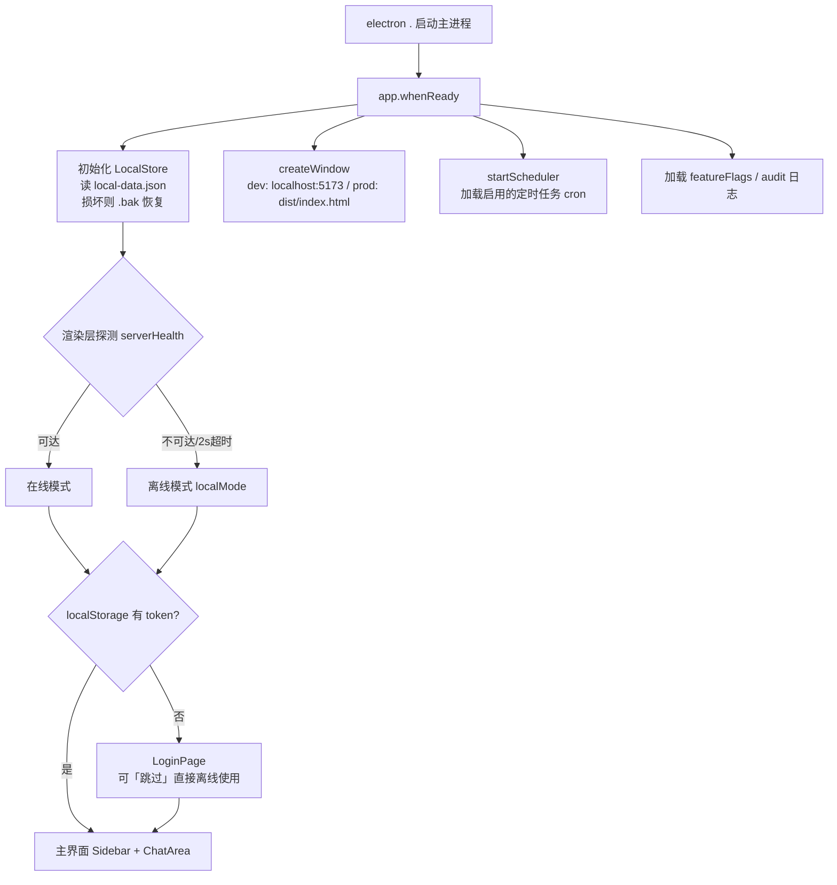
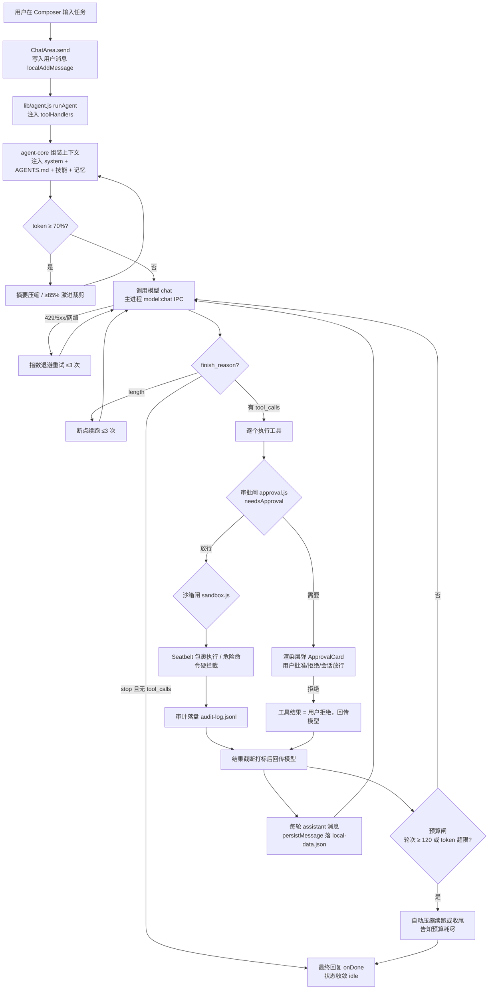
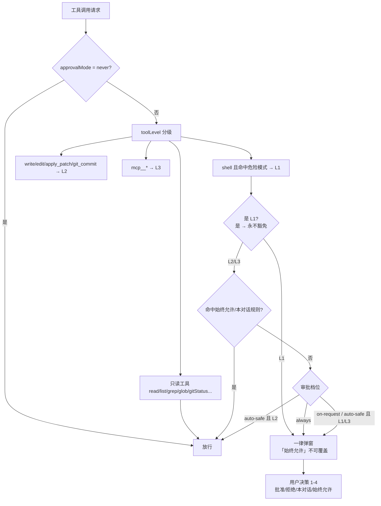
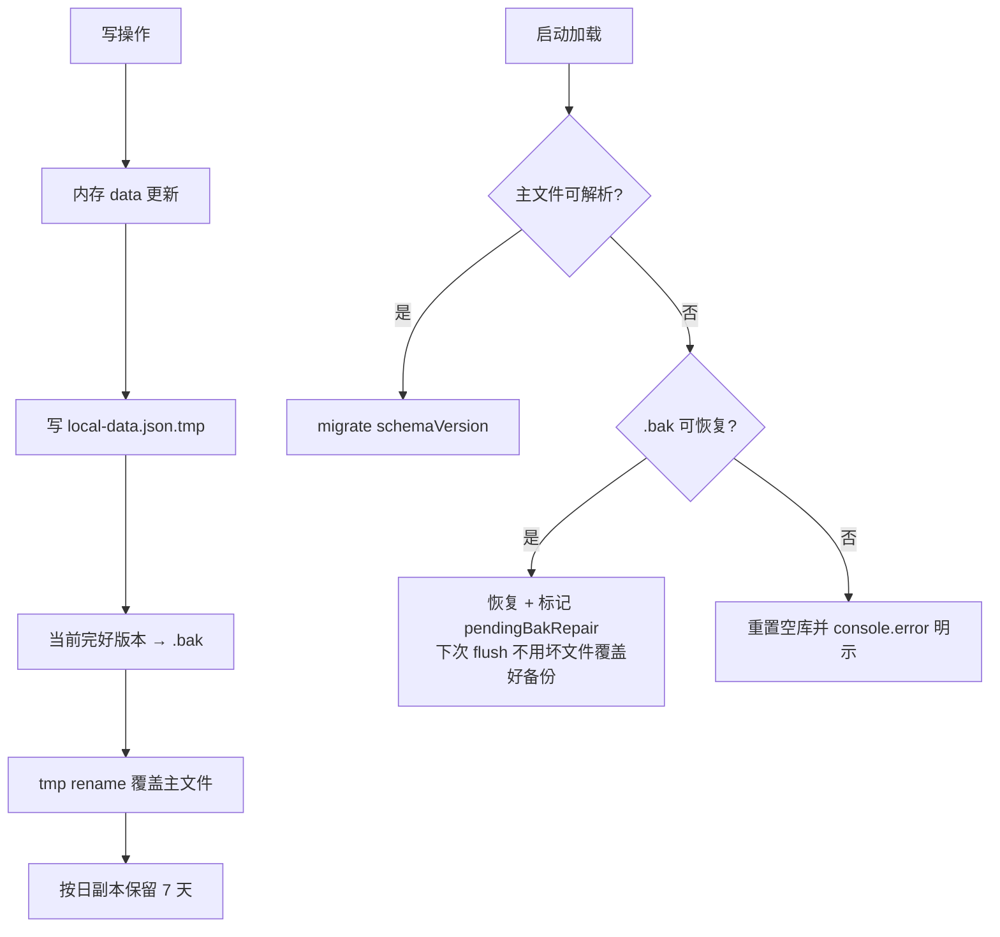
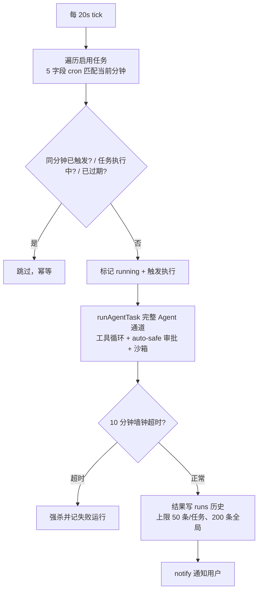
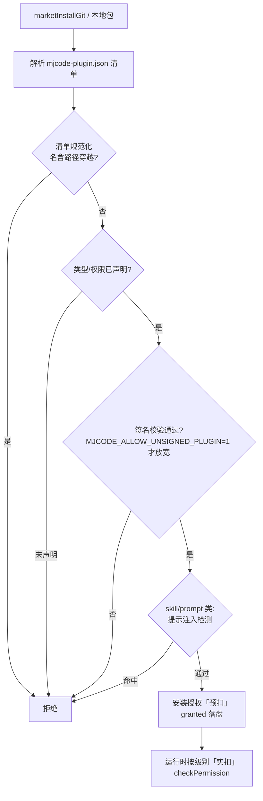

# MJ Code 项目逻辑与结构说明

> 面向新成员的项目导览文档。以**桌面端离线版本为主线**，覆盖代码结构、模块职责、核心业务流程与本地运行方式。
> 版本：v1.0.0 · 维护：技术经理审查版 · 最后更新：2026-10-14

---

## 1. 项目概览

**MJ Code** 是一款**本地优先（Local-First）的 AI 编码工作台**，Electron 桌面应用形态，对标 OpenAI Codex 桌面端。用户在本地选一个项目目录，与 AI Agent 对话，Agent 通过工具循环（读写文件、执行 shell、改 Git 等）在**本机沙箱内**完成编码任务，全程人工审批可控。

三条产品主线：

| 主线 | 含义 |
|---|---|
| **本地优先 / 离线可用** | 线程、消息、项目、模型凭证、偏好、记忆全部持久化在本机（`userData/local-data.json`），无需启动任何服务端即可完整使用；服务端缺失时自动进入离线模式，登录页可跳过 |
| **安全三道闸** | 审批分级（L1/L2/L3）→ 沙箱隔离（macOS Seatbelt + 跨平台危险命令硬拦截）→ 本地审计落盘，三道闸任何一道都 fail-closed |
| **Headless 引擎复用** | Agent 工具循环引擎（`agent-core`）零 Electron 依赖，同一引擎被三处复用：渲染层对话、本地定时任务、headless CLI |

典型用户旅程：启动应用 → 选项目目录 → 新建会话 → 输入任务 → Agent 多轮调用工具（每步过审批/沙箱闸）→ 产出 diff → 用户审查合并。

---

## 2. 目录结构说明

```
mj-code/
├── desktop/                    # ★ 主体：Electron 桌面应用（离线版核心，本文档重点）
│   ├── main/                   #   主进程（CommonJS，20 个模块）
│   │   ├── main.js             #     入口：窗口 + 全部 IPC 通道（约 2000 行）
│   │   ├── preload.js          #     contextBridge，暴露 window.mjcode.* 给渲染层
│   │   ├── approval.js         #     审批中心（分级判定纯函数）
│   │   ├── sandbox.js          #     沙箱（Seatbelt profile + 危险命令兜底守卫）
│   │   ├── localStore.js       #     本地数据层（JSON 原子持久化 + 三级备份）
│   │   ├── scheduler.js        #     本地定时任务调度器（20s 轮询 cron）
│   │   ├── computerUse.js      #     macOS AX 结构化 Computer Use（约 1200 行）
│   │   ├── pluginMarket.js     #     插件市场（fail-closed 安装与权限双闸）
│   │   ├── collab.js           #     协同：本地 Y.Doc 持久化与增量交换
│   │   ├── worktree.js/workspace.js  # Git 隔离工作区 / 项目工作区
│   │   ├── skills.js/skillCompat.js  # 技能加载与兼容层
│   │   ├── ecosystem.js/registry.js  # 生态资产（员工/连接器/技能）读取
│   │   ├── github.js/ide.js/voice.js  # gh CLI PR / IDE 跳转 / 语音转写
│   │   ├── degrade.js/featureFlags.js # 能力降级矩阵 / 功能开关
│   │   └── localStore 相关审计：audit-log.jsonl 由 main 落盘于 userData
│   ├── agent-core/             # ★ Headless Agent 引擎（ESM，零 Electron 依赖）
│   │   ├── index.js            #     runAgent 工具循环 + 上下文治理 + 预算闸（约 840 行）
│   │   └── cli.js              #     命令行入口（云端/脚本场景复用同一引擎）
│   ├── renderer/               #   渲染层（React 18 + Vite + Tailwind）
│   │   ├── src/App.jsx         #     根组件：视图编排、登录门禁、离线探测
│   │   ├── src/components/     #     32 个组件（见 §4.3 按功能域分组）
│   │   ├── src/lib/            #     agent.js(引擎包装)/api.js(双轨路由)/ipc.js 等 14 个
│   │   ├── src/hooks/          #     useVoice.js
│   │   └── src/styles/theme.css#     CSS 变量换肤（5 套预设 + 自定义强调色）
│   ├── test/                   #   35 套门禁测试（纯 node 脚本，零测试框架依赖）
│   ├── eval/                   #   SWE-bench 风格评测体系（tasks + verify fail-to-pass）
│   └── package.json            #   脚本入口：dev/build/test/eval*
├── server/                     # 可选配套：Node + Express + PostgreSQL（离线模式下不使用）
│   └── src/{routes,jobs,collab,db,config,middleware,lib}
├── miniprogram/                # 可选配套：微信小程序「控制面」（仅查看/审批，不执行代码）
├── ecosystem/                  # 内置生态资产（本地 JSON，不依赖网络）
│   ├── skills/                 #   100 个官方技能（SKILL.md 规范）
│   ├── digital-employees.json  #   50 个数字员工定义
│   └── mcp-connectors.json     #   100 个 MCP 连接器索引
├── shared/ docs/ .github/      # 共享代码 / 发布 Runbook / CI
└── MJCode-*.md                 # 过程文档（方案、审查报告、执行记录）
```

**结构要点**：

1. `desktop/main`（主进程，CJS）与 `desktop/renderer`（渲染层，ESM）是两个模块体系，通过 `preload.js` 的 `contextBridge` 单向桥接——渲染层**永远拿不到 Node 能力与 API Key**，只能调 `window.mjcode.*` 通道。
2. `desktop/agent-core` 是独立 ESM 包（`mj-code-agent-core`），引擎内**零 window / 零 Electron 依赖**，所有工具与模型调用经 `toolHandlers` 注入，这使它能同时跑在渲染层、定时任务与 CLI 中。
3. `server/`、`miniprogram/` 属于可选在线能力，**离线版主流程不依赖它们**；无服务端时应用启动即自动进入离线模式。

---

## 3. 技术栈与依赖说明

### 3.1 技术栈

| 层 | 技术 | 说明 |
|---|---|---|
| 桌面壳 | Electron 33 | 主进程 CommonJS，渲染层沙箱化（contextIsolation） |
| 前端 | React 18 + Vite 5 | JSX 组件化；Vite dev server 固定 5173 端口（strictPort） |
| 样式 | Tailwind CSS 3 + CSS 变量 | `theme.css` 以 CSS 变量实现 5 套主题换肤 |
| 类型检查 | TypeScript 5 | 仅 `tsc --noEmit` 校验（无编译产物），保持 JSX 轻量 |
| Markdown | react-markdown + remark-gfm | 消息区 GFM 渲染 + 代码块高亮 |
| 协同 | Yjs 13 | CRDT；本地 Y.Doc 落盘，离线先行、增量可交换 |
| 更新 | electron-updater | 打包态自动检查更新（手动确认安装） |
| 持久化 | JSON 原子写（localStore） | 零原生依赖，预留 better-sqlite3 升级路径 |
| 打包 | electron-builder 25 | mac dmg / win nsis / linux AppImage 三平台 |

### 3.2 依赖特点（刻意极简）

- **运行时依赖极少**：`desktop` 仅 `electron-updater` + `yjs`；`renderer` 仅 `react` / `react-dom` / `react-markdown` / `remark-gfm` / `yjs`。**没有任何 UI 组件库、状态管理库、HTTP 客户端**——状态就是 React useState，请求走 Electron IPC。
- **零测试框架**：35 套测试全是裸 `node test/xxx.test.js` 脚本，断言靠 `assert`，靠 `package.json` 的 `test` 脚本串联做门禁。
- **服务端依赖**（仅 server/ 使用，离线版无关）：Express、pg、bcryptjs、jsonwebtoken、croner、yjs。
- **系统能力依赖**：macOS 的 `sandbox-exec`（Seatbelt 沙箱）、`osascript`（Computer Use AX 树）、本机 `git`/`gh` CLI。非 macOS 平台沙箱降级为命令级硬拦截（见 §4.1）。

### 3.3 数据存储位置（全部在本机）

| 数据 | 位置 |
|---|---|
| 线程/消息/项目/私有模型凭证/偏好/记忆 | `userData/local-data.json`（`.bak` + 7 天日副本双保险） |
| 审批规则、插件安装记录、技能开关 | `userData/approval-rules.json` 等 |
| 本地审计日志（shell/写文件/审批放行） | `userData/audit-log.jsonl`（10MB 滚动） |
| 定时任务与运行历史 | `userData/scheduled-tasks.json` |
| 协同文档快照 | `userData/*.ydoc` |
| 模型 API Key | `safeStorage` 加密后存 local-data.json 的 `providers[].keyEncrypted` |

---

## 4. 各功能模块职责

### 4.1 主进程模块（`desktop/main`）

| 模块 | 职责 | 关键点 |
|---|---|---|
| `main.js` | 应用入口：创建窗口、注册全部 IPC 通道、组装工具执行 | 工具执行统一走 `runWriteTool`；shell 先过沙箱再过审批；打包态加载 `dist/index.html`，dev 态加载 `localhost:5173` |
| `preload.js` | `contextBridge.exposeInMainWorld('mjcode', {...})` | 渲染层唯一能力出口，约 100 个通道：`chat/shell/readFile/.../localThreads/market*/collab*` |
| `approval.js` | **审批中心（第一道闸）**：工具 → 风险分级 → 是否弹窗 | L1 危险命令 / L2 文件写 / L3 MCP 工具；只读工具永不用审；`auto-safe` 档 L2 自动放行；**L1 不接受任何「始终允许」豁免（fail-closed）**；规则前缀白名单匹配，防 `pnpm test && rm -rf /` 夹带 |
| `sandbox.js` | **沙箱隔离（第二道闸）** | 按策略生成 Seatbelt profile（read-only 禁写禁网；workspace-write 仅项目目录+临时目录可写）；非 macOS 或无 `sandbox-exec` 时走 `checkCommandGuard` 硬拦截 `rm -rf/sudo/git push/curl|sh` 等，审批不可绕过 |
| `localStore.js` | 本地数据层，全部离线数据的读写 | 原子写（tmp→rename）；三级防线：flush 前 `.bak` → 按日副本 7 天 → 损坏先 `.bak` 恢复才允许重置；`schemaVersion` 迁移链 |
| `scheduler.js` | 本地定时任务（离线可用） | 20s 轮询 5 字段 cron，同分钟幂等；执行通道是**完整 Agent**（工具循环+审批+沙箱），单任务 10 分钟墙钟超时，执行中不重复触发 |
| `computerUse.js` | macOS Computer Use（AX 树驱动 GUI 操作） | 纯函数解析/判定可单测；敏感词（支付/删除/验证码等）**逐次确认，不落规则库**；锁屏暂停；AX 覆盖不足降级视觉兜底 |
| `pluginMarket.js` | 插件市场（mcp/skill/prompt 三类） | 清单 `mjcode-plugin.json`；**fail-closed**：未声明权限、签名校验不过、提示注入检测不过一律拒装；权限双闸（安装预扣 + 运行实扣） |
| `skills.js` + `skillCompat.js` | 技能加载（SKILL.md 规范）与新旧格式兼容 | 内置技能根目录指向 `ecosystem/skills` |
| `collab.js` | 协同的主进程侧：Y.Doc 落盘 + 增量交换 | 只协同「会话线程/任务看板/审批流」，**代码协同归 git**；离线先行，UI 不等待网络 |
| `worktree.js` | Git 隔离工作区 | 创建/列表/合并回主目录/提升为分支/清理 |
| `workspace.js` | 项目工作区（项目一等实体） | 项目创建/探测（`tool:probeProject`） |
| `github.js` | GitHub PR 最小闭环 | 依赖本机 `gh` CLI 登录态（可选功能） |
| `degrade.js` + `featureFlags.js` | 能力降级矩阵与功能开关 | 渲染层按能力矩阵隐藏不可用入口，而非报错 |
| `voice.js` | 语音输入转写 | 录音 WAV → 转写（可配本地端点） |
| `ide.js` / `skills` / `registry` | IDE 跳转、技能列表、插件注册表 | 辅助能力 |

### 4.2 Agent 引擎（`desktop/agent-core`）——项目的心脏

`runAgent(options)` 是一次任务执行的全部：

- **内置工具集** `BASE_TOOLS`（13 个）：`shell / read_file / write_file / edit_file / apply_patch / list_dir / grep / glob / git_status / git_diff / git_log / git_commit / spawn_subagent`；外加注入的 `mcpTools` 与技能。
- **上下文治理**：token 估算驱动，70% 触发常规摘要压缩、85% 激进裁剪并告知模型；切点对齐完整轮边界；优先用上一轮真实 `usage` 替代全量估算。
- **双预算闸**：轮次硬顶（`maxTotalRounds`，上限 120）+ token 预算；超限先自动压缩续跑，续期指令旁路注入不污染会话历史。
- **截断续跑**：`finish_reason=length` 时从断点续跑最多 3 次。
- **大任务拆分**：`looksLargeTask` 本地启发式把关 → `decomposeTask` 产出分步计划 → 用户分步确认。
- **模型重试**：429/5xx/网络错误指数退避最多 3 次。
- **子代理**：`spawn_subagent` 仅授予只读工具子集（`SUBAGENT_TOOLS`），并有独立轮次预算。
- **可注入点**：`toolHandlers`（工具实现）、`persistMessage`（落库回调）、`onStream/onToolCall/onDone`（UI 回调）、`signal`（中止）。

### 4.3 渲染层组件（`desktop/renderer/src/components` 共 32 个，按功能域）

| 功能域 | 组件 | 说明 |
|---|---|---|
| **骨架与导航** | `Sidebar` `ThreadList` `StatusBar` `ProjectPicker` `CreateProjectForm` `PlusMenu` `CommandPalette`(⌘K) `ContextMenu` `feedback`(toast/confirm) `ErrorBoundary` | 侧栏项目/会话两级导航；命令面板；错误边界落盘崩溃日志并提供重试 |
| **对话核心** | `ChatArea` `ComposerControls` `ApprovalCard` `InlineAlert` `ContextRing` `CodeView` | 消息流、输入区、审批卡（快捷键 1-4 带输入焦点守卫）、上下文用量环 |
| **模型配置** | `ModelSelector` `SettingsModal` | 顶栏模型切换（全局+本地合并列表）；设置页 10+ 项均有读取消费方（`settings-coverage.test` 门禁） |
| **文件与变更** | `FileTree` `FileViewerPane` `FilePreview` `DiffReviewPanel` `RightPane` | 右侧面板三 tab：diff / 文件树 / 预览；diff 面板支持快照+撤销、一键建 PR |
| **任务与协作** | `ScheduledTasks` `TeamSpace` `ArchiveModal` | 定时任务管理、看板/审批卡协同、归档会话 |
| **生态** | `EcosystemModal` `MarketModal` | 生态中心（员工/连接器/技能）与插件市场 |
| **账户与引导** | `LoginPage` `Onboarding` `Dashboard` | 登录页提供「跳过」离线出口；首次引导（项目创建可跳过）；用量看板（离线返回本地统计） |
| **工作区** | `WorktreeBar` | 隔离工作区状态栏与收口操作 |

`lib/` 关键模块：`agent.js`（把 `window.mjcode.*` 组装成 `toolHandlers` 注入引擎的薄包装）、`api.js`（**服务端/本地双轨路由**，离线时短路到 localStore）、`ipc.js`（`withTimeout` + 契约归一化）、`mcpTools.js`、`collab.js`（渲染层持 Y.Doc）、`modelConfig.js`、`themes.json`。

### 4.4 可选配套模块（离线版不依赖，简述）

- **`server/`**：Express + PostgreSQL。账号/JWT、线程消息云同步、全局模型（管理员配置）、定时任务、云端委派队列（`queued→provisioning→running→review→done` 状态机，CAS 流转校验）、CRDT 增量同步服务、审计查询。两个功能开关默认关闭：`MJ_CLOUD_ENABLED` / `MJ_MINIPROGRAM_ENABLED`。
- **`miniprogram/`**：微信小程序**仅控制面**——绑定账号、查看云端任务、远程审批；不执行任何代码（安全边界）。
- **`ecosystem/`**：纯本地资产目录，桌面端直接读取：100 技能（SKILL.md + JSON 元数据）、50 数字员工（含系统提示词与审批策略）、100 MCP 连接器索引。

---

## 5. 核心流程图

### 5.1 应用启动流程



### 5.2 一次对话的 Agent 工具循环（核心业务流程）



**文字版（新员工必背五步）**：
1. 用户发消息 → 消息落本机；
2. 引擎组装上下文（系统提示 + AGENTS.md + 技能 + 记忆），先过**上下文压缩闸**；
3. 调模型，拿到 `tool_calls` 就执行，没有就收尾；
4. 每个工具调用连过三道闸：**审批闸**（L1/L2/L3 分级弹窗）→ **沙箱闸**（Seatbelt / 危险命令拦截）→ **审计落盘**；
5. 结果回传模型继续下一轮，直到完成——全程受**轮次/token 双预算**约束，中断可续跑、用户可随时中止。

### 5.3 审批判定（approval.js 决策表）



### 5.4 本地数据读写与韧性（localStore.js）



### 5.5 本地定时任务（scheduler.js）



### 5.6 插件安装（pluginMarket.js，fail-closed）



### 5.7 隔离工作区（worktree）与变更审查

```
用户在会话中要求开新工作区
  → worktree:create  在项目旁创建 git worktree（独立分支）
  → Agent 在 worktree 内改动，主目录不受影响
  → DiffReviewPanel 展示 diff（快照 + 可撤销）
  → 三条出路：合并回主目录 / 提升为正式分支 / 清理工作区
  → （可选）github:createPr 用本机 gh CLI 一键建 PR
```

### 5.8 Computer Use（macOS，computerUse.js）

```
cua:run {objective, appName}
  → osascript 取 AX 树 → parseAxTree 解析可交互节点
  → 模型看树选动作（click/type/key/scroll/set_value）
  → 动作含敏感词（支付/删除/验证码…）→ cua:approval-request 逐次确认
  → performAction 执行 → 推送 cua:event(step) 到 UI
  → AX 覆盖度不足 → fallback 视觉兜底；锁屏 → paused
  → 到达目标或 maxSteps → done
※ 审批决策不落规则库：敏感动作必须每次人工确认
```

---

## 6. 本地运行方式（离线版）

### 6.1 环境要求

- Node.js ≥ 20（建议 22）
- **无需** PostgreSQL、无需启动 `server/`、无需任何账号（登录页可跳过）
- 模型调用需自备 OpenAI 兼容端点（本地 Ollama 或任一兼容 API），在「设置 → 模型」里添加

### 6.2 启动步骤

```bash
# 1. 安装依赖（两个 package.json：desktop 主进程 + renderer 渲染层）
cd desktop
npm install
cd renderer && npm install && cd ..

# 2. 启动（dev 模式：Vite 5173 + Electron 并起，wait-on 等待 vite 就绪）
npm run dev
```

`npm run dev` 实际执行两条并行命令：
- `npm run dev:vite` → `cd renderer && npm run`（Vite dev server，端口 5173，strictPort）
- `wait-on http://localhost:5173 && electron .`（就绪后拉起 Electron）

首次启动：引导页 → **「跳过，暂不创建项目」或创建项目** → 主界面；顶栏「设置 → 模型」添加 Provider（Base URL + API Key + 模型名，Key 经 safeStorage 加密存本机）即可开始对话。

### 6.3 测试与质量门禁

```bash
cd desktop
npm test          # 35 套门禁测试串联，全绿才算通过
```

代表性测试：`approval`（审批分级）、`sandbox`（危险命令拦截）、`agent-core`/`agent-engine`（工具循环与预算）、`localStore`（数据韧性）、`tool-loop-guard`（防死循环）、`undef-ident`/`props-contract`/`ui-conventions`（前端语义与契约）、`render-smoke`（脏数据下首帧仍可渲染）、`settings-coverage`（设置项无假开关）。

评测体系（可选，需要模型端点）：

```bash
npm run eval:check   # 零成本：schema 校验 + fail-to-pass 基线自检
npm run eval -- --base-url http://localhost:11434/v1 --model qwen3.5:14b
```

### 6.4 打包分发

```bash
cd desktop
npm run build       # renderer vite build → electron-builder 三平台产物 → release/
```

产物命名 `MJCode-${version}-${os}-${arch}.${ext}`，输出到 `desktop/release/`。版本号与发布规范见 `docs/发布回滚Runbook.md`。

### 6.5 离线能力边界

| 能力 | 离线可用 | 说明 |
|---|---|---|
| 会话/消息/项目/归档 | ✅ | local-data.json 双轨路由自动切换 |
| 模型凭证与切换 | ✅ | safeStorage 加密存本机 |
| 工具循环/审批/沙箱/审计 | ✅ | 全部在主进程本地执行 |
| 定时任务 | ✅ | 主进程本地调度器，不依赖服务端 |
| 技能/插件市场（本地包）/生态中心 | ✅ | 读 `ecosystem/` 本地资产 |
| 协同看板 | ✅ | Y.Doc 本地先行，增量待联网交换 |
| 登录/注册、Dashboard 云端统计 | ❌ | 登录页可「跳过」；看板离线返回本地统计 |
| 云端委派、小程序、全局共享模型 | ❌ | 需服务端且功能开关默认关闭 |

---

## 7. 新成员阅读路线（建议顺序）

1. **跑起来**：按 §6 启动应用，点一遍侧栏 → 新建会话 → 让 Agent 改一个文件 → 观察审批弹窗与 diff 面板。
2. **看骨架**：`desktop/main/preload.js`（能力出口全表）→ `desktop/renderer/src/App.jsx`（视图编排）→ `desktop/renderer/src/lib/agent.js`（引擎怎么被调起来）。
3. **啃核心**：`desktop/agent-core/index.js` 的 `runAgent`（§5.2 流程的代码化）→ `desktop/main/approval.js` + `sandbox.js`（安全三道闸的前两道）。
4. **读数据**：`desktop/main/localStore.js`（离线根基）→ `lib/api.js`（双轨路由）。
5. **跑测试**：`npm test` 全绿后，挑 `test/approval.test.js`、`test/sandbox.test.js`、`test/agent-engine.test.mjs` 精读——测试即规格说明书。
6. **扩展阅读**：`CHANGELOG.md`（版本脉络）→ 根目录 `MJCode-*-审查报告-*.md`（历史问题与修复思路）→ `server/`（仅在需要在线能力时）。

---

## 附录：关键入口速查

| 想找什么 | 去哪里 |
|---|---|
| IPC 通道清单 | `desktop/main/preload.js` |
| 工具在主进程如何执行 | `desktop/main/main.js`（`tool:*` 各 handler、`runWriteTool`） |
| 工具如何被定义与循环 | `desktop/agent-core/index.js`（`BASE_TOOLS`、`runAgent`） |
| 审批规则与分级 | `desktop/main/approval.js` + `desktop/renderer/src/constants/approval.js` |
| 沙箱策略 | `desktop/main/sandbox.js`（`buildSeatbeltProfile`、`checkCommandGuard`） |
| 本地数据结构 | `desktop/main/localStore.js`（`EMPTY` 常量即全 schema） |
| 离线/在线路由 | `desktop/renderer/src/lib/api.js` |
| 定时任务 | `desktop/main/scheduler.js`（本地）/ `server/src/jobs/`（服务端） |
| 测试清单 | `desktop/package.json` → `scripts.test` |
| 发布与回滚 | `docs/发布回滚Runbook.md` |
